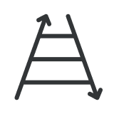
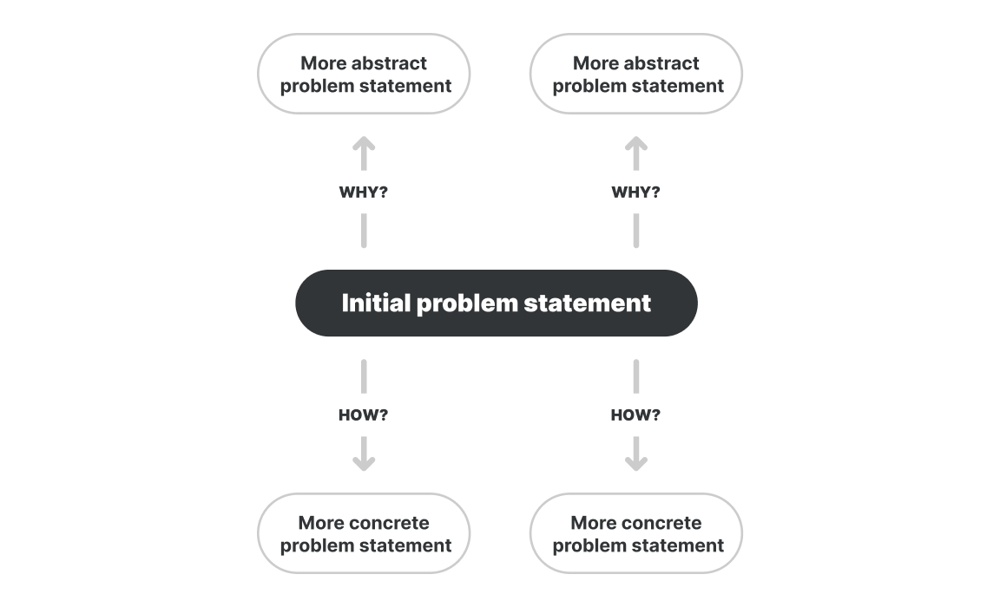
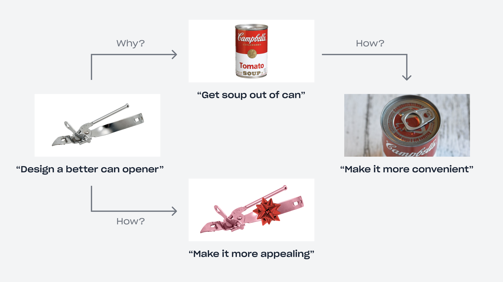
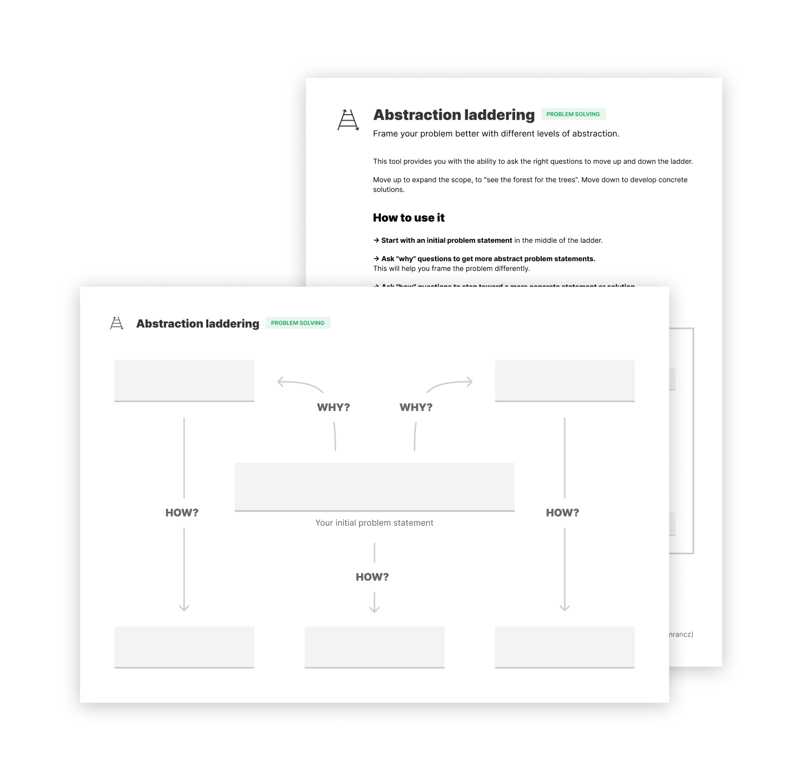

## 核心理解

在抽象与具体之间上下移动，重新界定问题，并从更大的目标或更具体的做法中发现新方向。

## 中文长文

通过不同抽象层级，更好地界定问题。

抽象阶梯法帮助我们更灵活地界定问题，弄清楚需要解决的究竟是什么，并跳出最初的问题表述。

这个工具通过一组恰当的问题，让你能够沿着阶梯向上或向下移动。

向上移动可以扩大问题范围，“跳出局部看整体”；向下移动则有助于提出具体方案。

## 如何使用

- 先把当前的问题写在阶梯中间。
  
- 追问“为什么”，得到更抽象的问题表述。这有助于从不同角度重新界定问题。
  
- 追问“如何”，走向更具体的问题或方案，从而产生不同于原始表述的新思路，也可能找到更有创意的解法。
  ​
  

这个工具可以用于设计流程中的任何阶段。个人或团队都能在短时间内使用它，几分钟就可以开始。

## 实际案例

下面是 Dropbox 设计师 Wes O'Haire 提供的一个简单例子：

他从“设计一款更好的开罐器”开始。先问“如何做到”，问题变得更具体：“让它更有吸引力”。

也可以向上追问：“我们为什么需要更好的开罐器？”

这会引出更抽象的问题：“怎样把罐头里的汤取出来？”接着可以问：“我们可以怎样把汤从罐头里取出来？”于是问题可以转变为：“让这件事更方便。”

## 动手练习

作者制作了抽象阶梯法的模板（PDF 和 Miro 版本），包含操作步骤和示例。

该模板可通过 Untools Vault 获取；其中还提供 Untools 的高级模板和每月专题内容。

模板与指南预览：

### 来源

[Wes O'Haire：《面向设计师的心智模型》](https://medium.com/dropbox-design/mental-models-for-designers-7c03d5e4a092)

[Autodesk：《抽象阶梯法》](https://www.autodesk.com/industry/manufacturing/resources/mechanical-engineer/abstraction-laddering)

# 回想：为什么这个问题重要？

## 名称

抽象阶梯法

## 适用情境

最初的问题表述限制了思路，或团队还没对要解决的问题达成一致时使用。它帮助你通过追问“为什么”回到更高层目标，再用“如何做”落到具体方案，在不同层次重新界定问题。

## 自问

- 为什么这个问题重要？
  
- 如果把问题说得更具体，下一步可以做什么？
  
- 我们真正想解决的目标是什么？
  

## 例子

- 把“设计一款更好的开罐器”向下追问“怎样让它更吸引人”，也可向上追问“为什么需要更好的开罐器”，直到重新表述为“怎样更方便地取出罐中食物”。
  

## 边界

- 问题和目标已经足够清楚，只需立即执行时
  

## 行动步骤

- 写下当前的问题表述
  
- 连续追问“为什么”以扩大抽象层级
  
- 连续追问“如何”以形成更具体的方向
  
- 比较不同层级的问题表述并选择适合的焦点
  

## 使用提示

帮助用户在抽象和具体层级间切换：先保留原问题，再分别追问“为什么”和“如何”，最后说明这些不同表述打开了哪些解决方向。

## 出处

Untools，《Abstraction laddering》：https://untools\.co/abstraction\-laddering/。中文内容据本地英文原文翻译。
