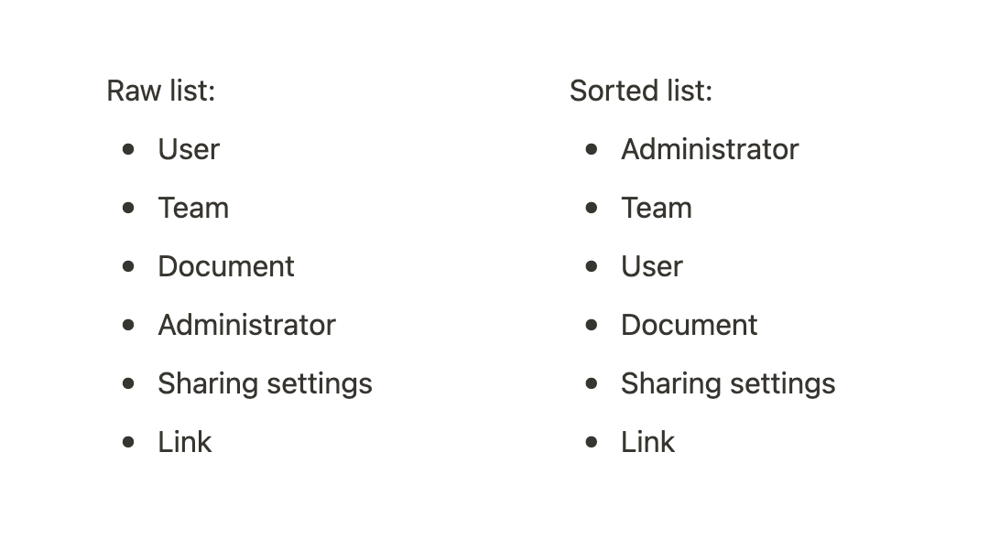
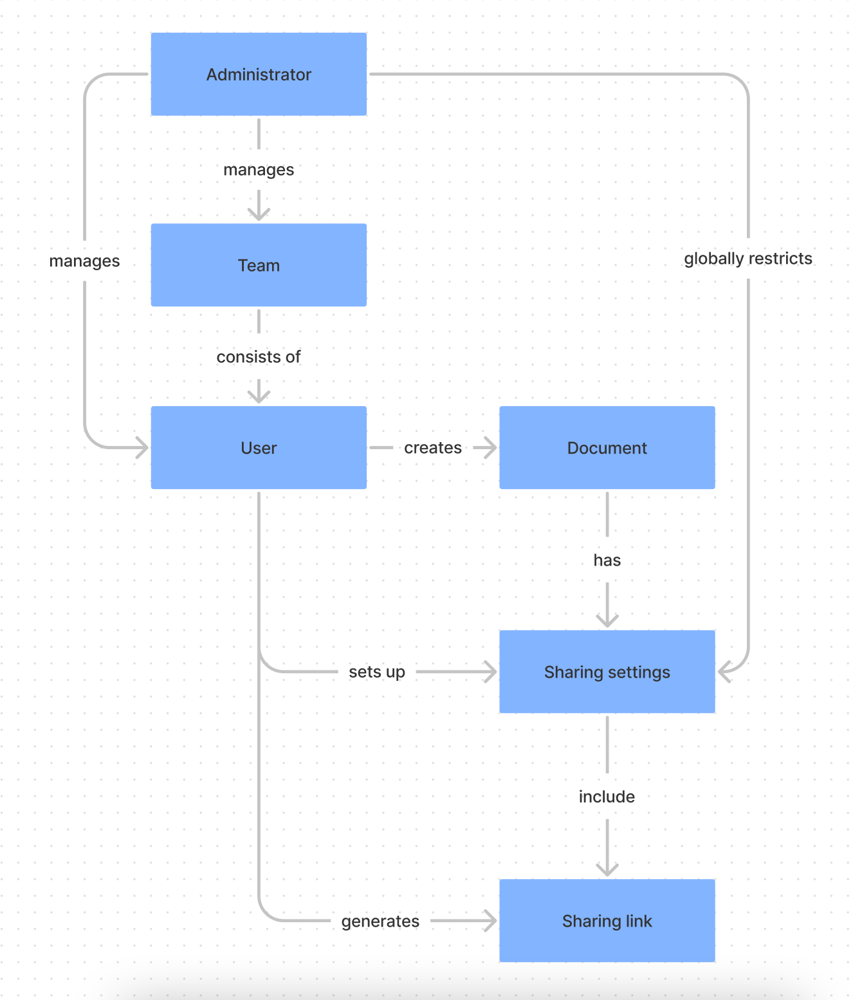

## 核心理解

把概念或系统中的实体及其关系可视化，用来呈现已有理解、组织知识并发现认知缺口。

## 中文长文

理解概念或系统中各实体之间的关系。

概念图有助于把对一个概念或系统的理解可视化，并呈现其中各实体之间的关系。

概念图的用途很多。其作者 Joseph Novak 和 Alberto Caňas 曾指出：“概念图已被证明可以帮助学习者学习、研究者创造新知识、管理者更好地组织和管理机构、作者写作，以及评估者评估学习。”

你可以独自绘制概念图，也可以在团队工作坊中使用。团队成员的概念图可以显露彼此理解的差异，帮助大家对齐认识。

### 如何使用

开始绘制之前，最好选择自己熟悉的知识领域，这样图中的关系更可能准确。这并不意味着必须事先无所不知；有一定基础知识就可以开始。

#### 1. 提出一个“焦点问题”

概念图需要情境。焦点问题能帮助你明确要回答什么，或这张概念图要用于什么目的。可以问：

- X 是如何运作的？
  
- Y 存在于什么情境中？
  

也可以从不同角度观察主题。你想理解的是某个事物的内部运作，还是它周围相互作用的关系？明确希望采用的视角会很有帮助。

#### 2. 找出关键实体

围绕你所在的领域或系统以及焦点问题，找出其中发挥作用的关键实体，例如人员、地点、组织、行动、流程、活动和方法等。

先用简单清单写下来。通常列出 15 到 25 个实体就足够了；面对复杂主题时，实体更多也没问题。

#### 3. 整理实体清单

这是正式绘图前的中间步骤。把实体从一般到具体排列，帮助你在图中建立更清晰的层级。

#### 4. 勾勒概念图

把实体写在便签上，摆放到实体上可以移动的（虚拟）白板中。移动实体有助于尝试表达它们之间的关系。

用线连接实体，并添加动词或短语来具体表示关系，例如“促成”“由……组成”或“创造”。

#### 5. 逐步补全概念图

此时，任选图中的两个实体，你都应该能把它们的关系读成有意义的句子，例如“设计师绘制概念图”。

照此继续补全地图。随着你逐渐理解其中的实体及其关系，可能需要尝试几次才能画好。

过程中可能会发现自己有知识缺口，需要先补上才能继续。这本身也是有价值的结果。

下面用一个简单例子说明整个过程。

### 示例

假设你刚加入一家开发 B2B 软件的公司，正在了解产品，具体主题是分享权限。

你先提出焦点问题：“这个产品中的分享权限是如何运作的？”

接着列出相关实体并整理清单：

清单可能会很长。记得经常对照焦点问题，检查列出的项目是否仍然与问题相关。

整理实体是建立层级和关系图的第一步。

接下来可以用更直观的方式勾勒图形并记录关系。你可以使用流程图软件，也可以直接在纸上草绘。

有了概念图之后，可以检查自己的理解是否完整，或还缺少哪些内容；也可以进一步思考如何改进这个概念或系统。

这里的例子经过了大幅简化。你实际绘制的概念图可能复杂得多，但这个例子能说明概念图如何帮助思考。

### 要点

概念图是一种通用而实用的工具，可以记录并发展我们对概念或系统的理解。它能把心智模型显化，并帮助发现知识缺口。

概念图几乎可以用于任何概念。除了帮助学习，它也可以支持你思考如何设计或改进某个事物。

### 来源

[Joseph Novak 和 Alberto Caňas，《概念图背后的理论以及如何构建和使用概念图》](http://cmap.ihmc.us/docs/theory-of-concept-maps.php#1-3)

[Jon Kolko，《揭开设计的奥秘》](https://www.goodreads.com/book/show/9634007-exposing-the-magic-of-design)

# 回想：这张图要回答的焦点问题是什么？

## 名称

概念图

## 适用情境

学习一个知识领域、梳理系统组成，或需要对齐团队理解时使用。它帮助你围绕焦点问题连接关键概念，用明确的关系说明它们怎样相连，并暴露理解中的缺口。

## 自问

- 这张图要回答的焦点问题是什么？
  
- 哪些实体参与其中？
  
- 实体之间可以组成哪些有意义的关系句？
  
- 当前理解还缺少什么？
  

## 例子

- 新加入 B2B 软件团队时，以“产品中的分享权限如何运作？”为焦点问题，列出用户、资源、角色和权限等实体，再连接并标注它们的关系。
  

## 边界

- 对主题几乎没有起始知识且无法核验关系时
  
- 只需要展示顺序步骤而无需表达概念关系时
  

## 行动步骤

- 确定熟悉的知识领域并写出焦点问题
  
- 列出相关人员、对象、组织、活动和方法等实体
  
- 按一般到具体排序
  
- 把实体放在画布上并用带含义的连线连接
  
- 检查关系能否读成完整句子并标出知识缺口
  

## 使用提示

引导用户先确定焦点问题，再列出实体、排列层级并用带有意义的连线表达关系；检查每组连接能否读成完整句子，并指出图中尚未解决的知识缺口。

## 出处

Untools，《Concept map》：https://untools\.co/concept\-map/。中文内容据本地英文原文翻译。

## 补充资料

