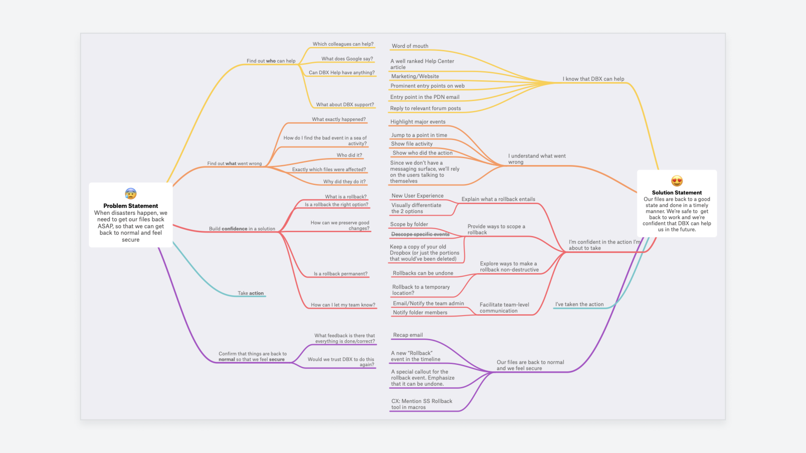

## 核心理解

面对习惯性做法时，明确最基本且有依据的事实、约束和目标，从这些前提出发重新构造方案。

## 中文长文

面对习惯性做法时，明确最基本且有依据的事实、约束和目标，从这些前提出发重新构造方案。

在哲学中，第一原理与论证的基本出发点有关；现代问题解决借用这个名称强调拆开事实与惯例。任务中的基本事实仍可能需要实测，不能把个人确信当成不可怀疑的真理。类比和已有经验也可以提供有价值的线索。

## 如何应用

1. 写出目标和不可忽略的约束。
   
2. 把事实、假设与习惯分开。
   
3. 构造替代方案并用实际条件检验。
   

## 一个例子

说明性示例：不先假定知识库必须有复杂图谱，先明确用户要保存、找到并理解知识，再选择满足这些需要的最小结构。

## 使用边界

不可能也没必要为每个日常问题从零证明一切。

复杂社会与工程系统可能存在尚未识别的约束。

## 出处与延伸阅读

- [Aristotle — Posterior Analytics, Book I](https://classics.mit.edu/Aristotle/posterior.1.i.html)
  
- [Untools — First principles](https://untools.co/first-principles/)
  

# 回想：哪些是测得的事实，哪些只是惯例？

## 名称

第一性原理

## 参考链接

https://classics\.mit\.edu/Aristotle/posterior\.1\.i\.html

## 适用情境

既有做法被当成理所当然，或沿用类比已难以找到合适方案时使用。它帮助你分开有依据的事实、待验证假设和习惯，从目标与约束出发重新构造并检验方案。

## 自问

- 哪些是测得的事实，哪些只是惯例？
  
- 如果取消某个习惯，真正的约束还在吗？
  

## 例子

- 说明性示例：不先假定知识库必须有复杂图谱，先明确用户要保存、找到并理解知识，再选择满足这些需要的最小结构。
  

## 边界

- 不可能也没必要为每个日常问题从零证明一切。
  
- 复杂社会与工程系统可能存在尚未识别的约束。
  

## 行动步骤

- 写出目标和不可忽略的约束。
  
- 把事实、假设与习惯分开。
  
- 构造替代方案并用实际条件检验。
  

## 使用提示

应用时：写出目标和不可忽略的约束。 把事实、假设与习惯分开。 构造替代方案并用实际条件检验。 不可能也没必要为每个日常问题从零证明一切。

## 出处

Aristotle — Posterior Analytics, Book I — https://classics\.mit\.edu/Aristotle/posterior\.1\.i\.html
Untools — First principles — https://untools\.co/first\-principles/

## 补充资料

[https://fs.blog/2018/04/first-principles/](https://fs.blog/2018/04/first-principles/)

[https://medium.com/dropbox-design/mental-models-for-designers-7c03d5e4a092](https://medium.com/dropbox-design/mental-models-for-designers-7c03d5e4a092)

## 相关卡片

[奥卡姆剃刀](../occams-razor/article.md) · 常一起使用：先澄清基本事实，再比较是否引入不必要假设。

[笛卡尔方法](../cartesian-thinking/article.md) · 相关：两者都帮助检查前提；分解与复查是前者强调的操作。

## 第一性原理思维 · 模型补充

### 适用情境

一种昂贵的做法沿用了多年，你需要重新判断哪些约束真的不可改变。

### 原理与用法

把报价、惯例和别人给的方案拆成底层约束，再从物理、数量或需求约束重新组合。列出哪些条件已经测量，哪些只是沿用的做法，从最可能改变方案的一项开始核实。

### 编辑示例与边界

仓储“必须买更大货架”可拆为箱体尺寸、通道净宽、同时在库量和取放频次。调整到货批次也许就够了。材料费只能给出部分下限，还得计入交付、维护和组织实施成本。

### 参考资料

邦比快跑《Munger Models》，第13章《第一性原理思维》。

## 相关模型

- [逆向思考](../inversion/article.md) — 从基本约束重建方案后，倒问哪项约束一旦不满足就会失败，再用测量或试验验证它。
  
- 从基础事实推导若得到两个解释力相同的方案，可用[奥卡姆剃刀](../occams-razor/article.md)先检验额外假设较少的一个。
  
- [能力圈](../../%E6%8A%95%E8%B5%84%E5%AD%A6%E4%B8%8E%E9%87%91%E8%9E%8D%E5%AD%A6/circle-of-competence/article.md) — 正确识别第一性原理需要对该领域有深刻理解，否则会把假设误认为基本事实。
  
- [跨学科思维](../multidisciplinary-approach/article.md) — 分别从物理容量、资源成本等基本约束推导方案，再核对它们能否同时满足，避免把类比误当验证。
  
- [避免意识形态偏见](../avoiding-ideology/article.md) — 把被称作“理所当然”的前提分成可测事实与价值偏好，能防止未经检验的教条混入基础推导。
  
- [铁锤人倾向](../man-with-a-hammer-syndrome/article.md) — 先描述问题必须满足的约束，再选工具，可减少把问题改写成熟悉方法所能解决的样子。
  
- [多元思维模型框架](../latticework-of-mental-models/article.md) — 多元模型的价值在于提供多个不同的基本原理视角来审视同一问题。
  
- [地图不是疆域](../map-is-not-the-territory/article.md) — 第一性原理思维提醒你区分模型与现实：任何理论框架都只是地图，不是疆域本身。
