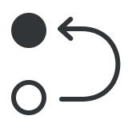
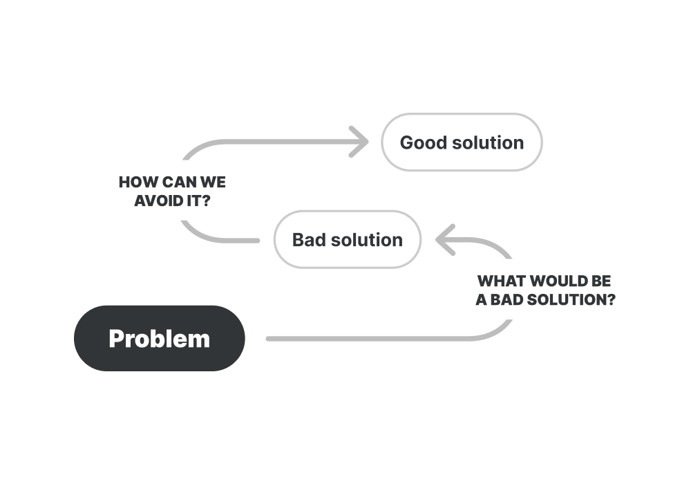

## 核心理解

从不希望发生的结果或失败方式出发，倒推需要避免或检验的条件，再用于改进正向方案。

## 中文长文

从不同角度看待问题。

当你需要从不同角度审视正在解决的问题时，逆向思考很有帮助。它能让你换个视角，并设想最坏的情况。

## 如何使用

判断是否适合逆向思考，可以先问：“我是不是只在考虑理想的方案或情境？”

然后反过来思考问题或方案，按以下步骤进行：

1. 问自己：在这种情况下，最糟糕的决定或方案是什么？
   
2. 问自己：它为什么会很糟？把原因写下来。
   
3. 根据这些糟糕决定的成因，反过来尝试提出好的决定或方案。
   ​
   

逆向思考帮助你看见不好的结果，从而避免它们。

以下问题也能帮助你换到相反的视角：

- 事情可能怎样出错？
  
- 与当前做法相反的做法是什么？
  
- 怎样做会让方案变糟？
  

## 实践中的逆向思考

项目经理会使用一种称为“事前验尸”的练习来进行逆向思考。

团队想象时间来到六个月后，自己负责的项目已经失败，然后围绕这一设想提问：“出了什么问题？”“我们犯了哪些错误？”“这个项目为什么会失败？”

这样，团队能提前看到潜在陷阱并做好准备。通过逆向思考，他们可以避免可能的错误和糟糕结果。

### 来源

[Wes O'Haire，《面向设计师的心智模型》](https://medium.com/dropbox-design/mental-models-for-designers-7c03d5e4a092)

---

## 核实补充：定义、应用与边界

从不希望发生的结果或失败方式出发，倒推需要避免或检验的条件，再用于改进正向方案。

从成功愿望出发容易遗漏失败路径。反向提问能增加候选风险，但这些风险仍需证据与优先级判断。避免若干失败条件也不保证达到目标，还需检查正向价值。

## 如何应用

1. 明确目标和不可接受结果。
   
2. 列出导致失败的具体条件。
   
3. 把关键条件转成预防或检测措施，再复核正向价值。
   

## 一个例子

说明性示例：先列导入可能怎样失败：重复身份、原文丢失、部分写入；再落实去重、保留正文、事务与恢复验证。

## 使用边界

想象得到的风险不等于会发生，应检查机制和后果。

避免失败不代表创造了足够收益。

## 出处与延伸阅读

- [Untools — Inversion](https://www.untools.co/inversion/)
  

# 回想：怎样做最容易让这件事失败？

## 名称

逆向思考

## 参考链接

https://www\.untools\.co/inversion/

## 适用情境

审查重要方案，发现自己只关注理想结果、还没想清失败路径时使用。它帮助你从不希望出现的结果反推可能条件，提出预防或检测措施，再核对这些风险是否有依据。

## 自问

- 怎样做最容易让这件事失败？
  
- 哪些失败条件已经出现在方案中？
  

## 例子

- 说明性示例：先列导入可能怎样失败：重复身份、原文丢失、部分写入；再落实去重、保留正文、事务与恢复验证。
  

## 边界

- 想象得到的风险不等于会发生，应检查机制和后果。
  
- 避免失败不代表创造了足够收益。
  

## 行动步骤

- 明确目标和不可接受结果。
  
- 列出导致失败的具体条件。
  
- 把关键条件转成预防或检测措施，再复核正向价值。
  

## 使用提示

应用时：明确目标和不可接受结果。 列出导致失败的具体条件。 把关键条件转成预防或检测措施，再复核正向价值。 想象得到的风险不等于会发生，应检查机制和后果。

## 出处

Untools — Inversion — https://www\.untools\.co/inversion/

既有文章来源: https://untools\.co/inversion/

## 相关卡片

[冗余与备份](../../%E5%B7%A5%E7%A8%8B%E5%AD%A6/redundancy/article.md) · 常一起使用：先列会同时破坏全部副本的故障，再设计隔离与恢复演练。

[二阶思维](../second-order-thinking/article.md) · 常一起使用：分别检查失败路径与后续连锁反应，显式记录假设。

## 逆向思维 · 模型补充

### 适用情境

方案有一长串成功理由，却没人说清哪项失误足以让它失败。

### 原理与用法

把目标反过来问一次。一个项目怎样才一定会失败？列出足以毁掉结果的条件，区分能预防、能监测和只能承受的风险，再为最严重的一项安排动作。

### 编辑示例与边界

例如，活动能够吸引多少听众很难预测，但只要现场进不去，再好的讲者也白费。提前走一遍入场流程能排除这一种失败。余下仍要回答听众为什么愿意来，排除了失败条件并不等于已经创造了价值。

### 参考资料

邦比快跑《Munger Models》，第1章《逆向思维》。

## 相关模型

- 从失败倒推既可找到客观约束，也可发现判断偏差。用[双轨分析](../two-track-analysis/article.md)把设备容量不足和团队过度乐观分开核查。
  
- 把自己判断的反面当作待查假设，再像[达尔文式客观态度](../darwinian-objectivity/article.md)所要求的那样，立即记下不利观察，保留作日后核对。
  
- 逆向思维的“灾难因素清单”就是一种特殊的[检查清单](../checklist-method/article.md)。
  
- [避免意识形态偏见](../avoiding-ideology/article.md) — 先问什么会使论证失效；若无论出现什么反例都能用同一套教条解释，就应重新审视自己的立场。
  
- 从估值可能高估的原因倒推，再检验买价与保守估值之间的[安全边际](../../%E6%8A%95%E8%B5%84%E5%AD%A6%E4%B8%8E%E9%87%91%E8%9E%8D%E5%AD%A6/margin-of-safety/article.md)能承受多大的误差。
  
- 倒推失败路径时，[能力圈](../../%E6%8A%95%E8%B5%84%E5%AD%A6%E4%B8%8E%E9%87%91%E8%9E%8D%E5%AD%A6/circle-of-competence/article.md)提醒你标出自己不熟悉的环节，请掌握一手情况的人补充遗漏。
  
- [奥卡姆剃刀](../occams-razor/article.md) — 反向列出方案必须满足的条件。若两个方案都符合证据，可以先检验依赖额外假设较少的那个。
  
- [事前验尸](../premortems/article.md)是假定计划已经失败，再倒推可能原因；即使是很普通的交接遗漏，也值得进入排查范围。
