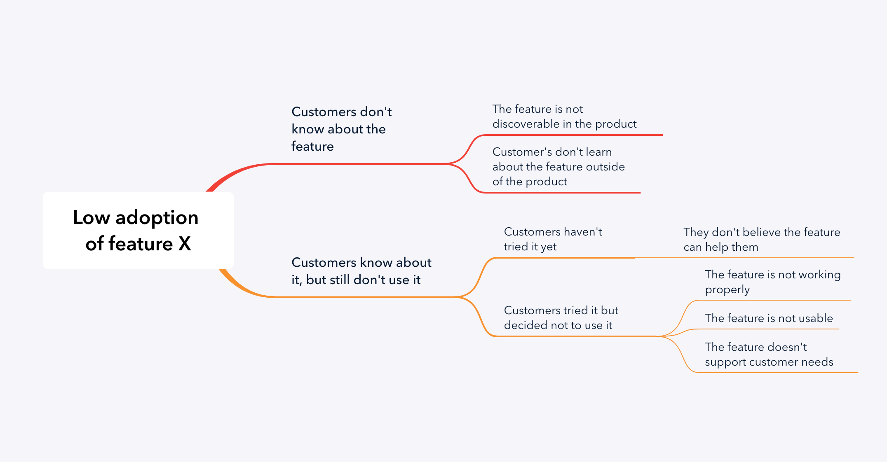
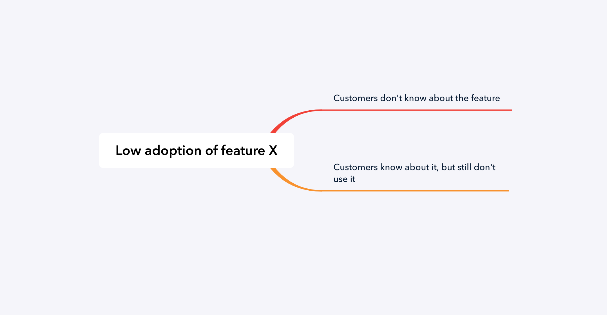

## 核心理解

把复杂问题拆成层次清楚的子问题或原因，帮助系统分析、确定重点并沟通问题结构。

## 中文长文

以系统的方式组织和解决问题。

问题树本质上是问题地图。它提供清晰、系统的方式来审视要解决的问题，帮助你把大问题拆成更小、更容易处理的问题，并确定其中某些部分的优先级。换句话说，它适用于“分而治之”的策略。

问题树也很适合与他人沟通，因为它能把问题结构清楚地呈现出来。

问题树主要有两类：

1. 问题树：通过追问“为什么？”来构建。
   
2. 方案树：通过追问“如何做？”来构建。
   

## 如何创建问题树

### 问题树

一棵好的问题树应该覆盖整个问题，并且结构严谨。创建时可以遵循以下原则：

1. 先把问题拆分成彼此不同的类别或分支。
   
2. 使用 MECE 原则：相互独立、完全穷尽。
   
   - 相互独立意味着树中不同部分没有重叠；完全穷尽意味着它们共同覆盖整个问题。
     
   
3. 不要过早深入具体细节或假设；先抓住组成问题的主要类别。
   
4. 运用 80/20 法则，优先关注影响最大的少数问题部分。
   
   - 这种判断最好以数据为依据，而不是只凭自己的假设。
     
   

### 方案树

当你选出问题中希望重点处理的部分后，可以接着创建方案树：

1. 针对想改善的问题部分，追问：“我们可以如何改进或修复它？”
   
2. 把潜在方案分成不同类别。
   
3. 在每个类别下继续提出想法。
   

这种结构化思考方式的优点是：限制条件反而能帮助你生成更多想法。

## 示例

假设你在做一个产品，发现用户没有采用其中一项关键功能。可以从这个现象开始构建问题树。

先把它分解成可能的原因：

- 功能 X 的采用率低。
  
  - 用户不了解这项功能。
    
    - 用户了解这项功能，但仍然没有使用。
      
    
  

这只是非常基础的第一层分解，但已经符合 MECE：各部分互相独立，同时覆盖了问题。

继续展开后，可以得到下面这棵树：

- 功能 X 的采用率低。
  
  - 用户不了解这项功能。
    
    - 在产品中不容易发现这项功能。
      
      - 用户在产品之外也没有了解到这项功能。
        
      
    
  - 用户了解这项功能，但仍然没有使用。
    
  - 用户还没有尝试这项功能。
    
    - 他们不相信这项功能能帮助自己。
      
      - 用户试用后决定不再使用。
        
      
    - 这项功能不好用。
      
      - 功能无法正常运行。
        
      - 功能无法满足用户需求。
        
      
    
  

我们还可以继续调查，但现在已经能看出从问题的哪一部分入手。在这个例子中，了解用户对功能的认知情况应当优先调查：功能本身可能没有问题，只是用户不知道它。

这个例子展示了一个简单的问题树如何帮助拆解问题，并为解决问题提供起点。

## 要点

问题树通过拆分问题，帮助我们系统地处理问题。根据当前所处的解决阶段，你可以通过追问“为什么？”绘制问题树，也可以通过追问“如何做？”绘制方案树。

### 来源

[Crafting Cases，《问题树权威指南》](https://www.craftingcases.com/issue-tree-guide/)

# 回想：要解释或解决的核心问题是什么？

## 名称

问题树

## 适用情境

问题过于笼统、不知道从哪里着手，或需要向团队说明问题结构时使用。它帮助你将问题拆成较清楚的分支，通过追问原因或做法，确定进一步调查和处理的方向。

## 自问

- 要解释或解决的核心问题是什么？
  
- 子问题是否互不重叠且覆盖整体？
  
- 哪些分支最可能影响结果？
  
- 下一步如何改善或修复重点分支？
  

## 例子

- 分析某功能采用率偏低时，可从用户是否了解功能、是否尝试、是否相信其价值以及功能是否易用等方向分解并验证。
  

## 边界

- 尚未定义核心问题就继续细分
  
- 把未经数据验证的假设写成事实
  
- 分支存在明显重叠或遗漏时
  

## 行动步骤

- 写下核心问题
  
- 用“为什么”分解成问题树，或用“如何”建立方案树
  
- 保持分支互斥且共同覆盖问题
  
- 优先调查影响大的分支
  
- 将重点问题转为改进方向并生成方案
  

## 使用提示

先写清树的起点，再选择用“为什么”构造问题树或用“如何”构造方案树；检查分支是否互不重叠且覆盖整体，优先关注有数据支持、影响较大的部分。

## 出处

Untools，《Issue trees》：https://untools\.co/issue\-trees/。中文内容据本地英文原文翻译。
