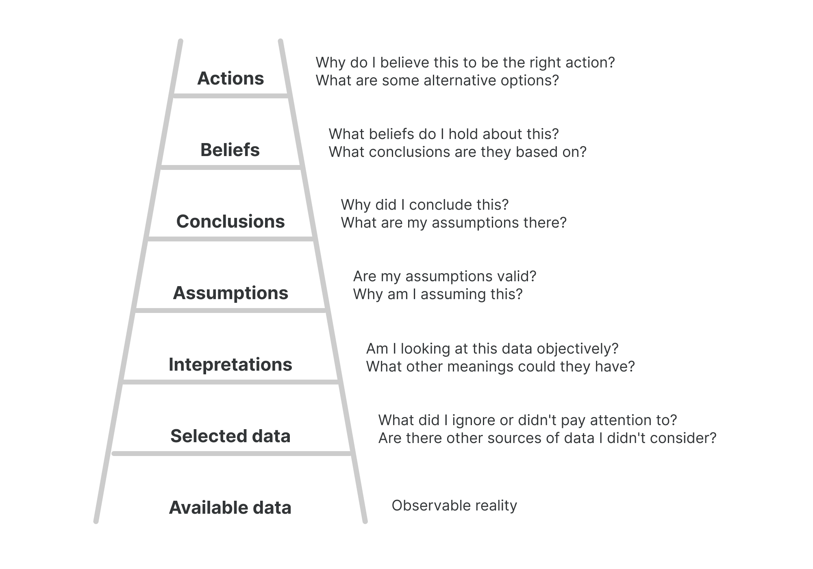
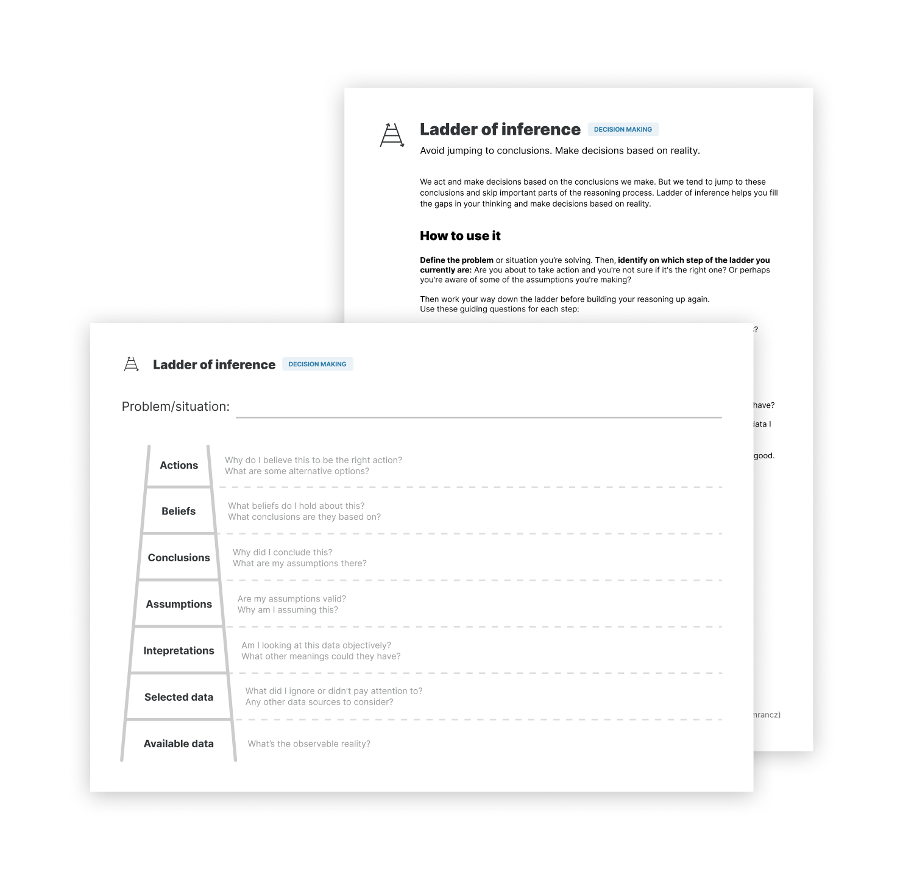

## 核心理解

沿着观察数据、选择信息、解释、假设、结论、信念到行动的路径回溯，检查自己如何从有限信息得出判断。

## 中文长文

避免仓促下结论，依据现实作出决定。

我们会根据自己得出的结论采取行动并作出决定，但我们常常直接跳到结论，省略推理过程中的重要环节。

推论阶梯由哈佛前教授 Chris Argyris 提出，帮助你补全思考中的缺环，并依据现实作出决定。它也有助于质疑他人的推理过程，让大家共同得出更好的结论。

## 推论阶梯

阶梯上的七个步骤代表我们的思维过程，从底部到顶部依次如下：

1. **可获得的数据**
   
   - 我们能够观察到的现实。
     
   
2. **选取的数据**
   
   - 我们根据以往经验和既有信念，选择注意哪些信息。我们无法在头脑中处理所有可用数据，因此必须作出选择。
     
   
3. **解释**
   
   - 我们赋予事实含义，并转述看到或听到的信息，以便理解。
     
   
4. **假设**
   
   - 根据自己的解释，形成个人假设。
     
   
5. **结论**
   
   - 从假设中推导出结论。
     
   
6. **信念**
   
   - 我们的结论逐渐形成自己的信念。
     
   
7. **行动**
   
   - 最后，我们依据认为真实的信念采取行动。
     
   

这些过程通常会在大脑中无意识、快速地发生。刻意使用推论阶梯，能让你停下来看看自己在哪一步跳到了结论。

## 如何使用

每当你对某件事得出结论，或准备根据结论作决定时，都可以停下来检查自己的推理。

首先，确定自己目前位于阶梯的哪一步。你是不是马上要采取行动，却不确定这是否妥当？或者，你已经意识到自己正在作出某些假设？

接着先沿阶梯向下检查，再重新向上推理。可以针对每一步问自己：

- **行动：**
  
  - 我为什么认为这是正确的行动？还有什么替代做法？
    
  
- **信念：**
  
  - 我持有哪些信念？这些信念基于哪些结论？
    
  
- **结论：**
  
  - 我为什么得出这个结论？当时有哪些假设？
    
  
- **假设：**
  
  - 我的假设有效吗？我为什么会这样假设？
    
  
- **解释：**
  
  - 我是在客观地看待这些数据吗？它们还可能有哪些含义？
    
  
- **选取的数据：**
  
  - 我忽略或没有注意到什么？还有其他数据来源没有考虑吗？
    
  

回答这些问题时，你的推理可能会发生变化，这是好事。到达阶梯底部后，再更有意识、更审慎地逐步向上推理。

## 示例

下面看一个在实际情境中运用推论阶梯的例子。

假设我负责一个开发团队。最近一位开发者的表现不佳：他错过了截止日期，导致好几个项目延期。我由此认定他不适合这份工作，于是决定解雇他。

不过，我停下来问自己：这真的是正确的做法吗？我可以用推论阶梯拆解思考，也许能作出更好的决定。我逐一提问：

- 为什么我认为解雇他是正确的行动？因为我觉得他不适合这份工作。
  
- 这个信念基于什么结论？我认为他不是一名合格的开发者。
  
- 我的假设是什么？我假定他最近的表现足以代表他的能力（或缺乏能力）。
  
- 我为什么这么假设？因为错过截止日期意味着效率低。
  
- 我看到的数据还可能有什么别的含义？错过截止日期也可能说明期限不合理，或者他花了更多时间来交付高质量代码。
  
- 有没有其他数据来源没有考虑？我还没有直接问过他。与他沟通后，或许能发现错过截止日期的真实原因。
  

这是一个经过简化的例子，展示了我们想避免的跳跃式推理：“错过截止日期 → 效率低 → 不合格的开发者 → 应当解雇”。把推理拆开后，我能更客观地看待情况，也可能发现不同原因，例如期限太紧，或他正在经历个人困难。这些原因都不应直接成为解雇他的理由。

推论阶梯帮助我避免作出糟糕且过早的决定。

## 动手练习

作者制作了推论阶梯模板（PDF 和 Miro 版本），包含操作步骤和示例。

该模板可通过 Untools Vault 获取；其中还提供 Untools 的高级模板和每月专题内容。

模板预览：

### 来源

[Peter Senge，《第五项修炼：学习型组织的艺术与实践》](https://www.goodreads.com/book/show/255127.The_Fifth_Discipline)

[Trevor Maber，《重新思考思考》](https://www.youtube.com/watch?v=KJLqOclPqis)

[Systems Thinker，《推论阶梯》](https://thesystemsthinker.com/the-ladder-of-inference/)

# 回想：我观察到的原始数据是什么？

## 名称

推论阶梯

## 适用情境

对他人的行为迅速下结论，或团队面对同一事实却形成不同判断时使用。它帮助你回溯选取了哪些信息、作了哪些解释和假设，找出需要补证据或重新讨论的环节。

## 自问

- 我观察到的原始数据是什么？
  
- 我选择关注了哪些信息，又忽略了什么？
  
- 还有哪些可能的解释？
  
- 我的假设和结论分别是什么？
  
- 这些信念如何导致当前行动？
  

## 例子

- 员工错过截止日期不一定说明能力不足，也可能是截止日期不合理或为了代码质量投入了更多时间；先询问当事人并检查其他数据，再决定如何处理。
  

## 边界

- 把主观解读当作事实，或在没有新证据时只反复推演
  

## 行动步骤

- 识别当前准备采取的行动或已形成的结论
  
- 沿阶梯向下追问信念、结论、假设、解释和选取的数据
  
- 寻找忽略的资料与其他解释
  
- 回到可观察事实
  
- 基于更完整的证据重新形成判断并审慎行动
  

## 使用提示

帮助用户从行动或结论沿推论阶梯向下追查信念、结论、假设、解释和选取的数据；寻找被忽略的信息与替代解释，再回到可观察事实后重新推理。区分事实与推断，不替当事人断定动机。

## 出处

Untools，《Ladder of inference》：https://untools\.co/ladder\-of\-inference/。文章还引用 Peter Senge、Trevor Maber 和 Systems Thinker；中文内容据本地英文原文翻译。
