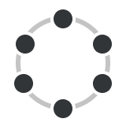
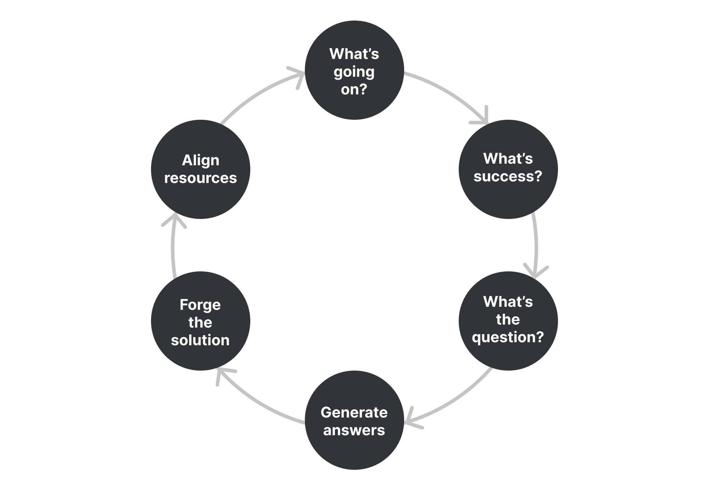

## 核心理解

通过理解问题、定义成功、提出关键问题、生成答案、筛选方案并协调资源，以结构化流程促进创造性解决问题。

## 中文长文

以有创意且高效的方式解决问题。

运用更有结构、更具批判性的思考，可以帮助你更好地理解问题，并提出更有创意的解决方案。Tim Hurson 提出的高效思维模型可以帮助你做到这一点。

当问题已经界定清楚、你正在寻找有创意的解决方案时，这个模型最适用。

## 如何使用

这个工具提供一个由六步组成的问题解决框架：

1. 询问“现在发生了什么？”
   
2. 询问“怎样才算成功？”
   
3. 询问“必须回答的问题是什么？”
   
4. 生成答案。
   
5. 打磨解决方案。
   
6. 协调资源。
   ​
   

下面逐步说明。

#### 1. 询问“现在发生了什么？”

第一步是更好地理解问题。可以用以下问题引导思考：

- 问题究竟是什么？
  
- 问题造成了什么影响？
  
- 我已经知道什么？掌握了哪些信息？
  
- 哪些人参与其中？
  
- 问题解决后，未来会是什么样子？
  *Hurson 将其称为“目标未来”（Target Future）。*
  

把得到的答案记录下来，后续步骤还会用到。

#### 2. 询问“怎样才算成功？”

这一步帮助你定义目标未来中的成功状态。

可以用 DRIVE 框架提出成功标准：

- 你希望解决方案**做到**什么？
  
- 有哪些**限制**？它绝不能做什么？
  
  - 在这里可以使用[逆向思考](https://untools.co/inversion)来帮助梳理。
    
  
- 可以为此**投入**哪些资源？
  
- 解决方案应具备哪些**价值**？
  
- **必要结果**是什么？
  

可以反复讨论这些问题，直到成功的样子足够清楚。

#### 3. 询问“必须回答的问题是什么？”

现在要提出必须回答的问题，才能实现目标未来。Hurson 将这些问题称为“催化问题”。

使用前两步收集的信息来提问。“我们可以怎样……？”或“我如何才能……？”这样的句式有助于组织问题。

#### 4. 生成答案

尝试为催化问题想出尽可能多的答案。开展头脑风暴，暂时不作评判，把想法收集起来。这些都是潜在解决方案。

下一步再从中筛选最有希望的想法。

#### 5. 打磨解决方案

进一步开发之前，先选出最好的方案。把上一步的想法逐一与第二步定义的成功标准比较。可以使用[决策矩阵](https://untools.co/decision-matrix/)辅助筛选。

选出方案后，再思考如何改进它，以及怎样让它更符合成功标准。

#### 6. 协调资源

最后一步是开始准备执行方案。

写下需要采取哪些行动、需要哪些资源，并明确谁负责整体方案以及每个部分。

尽量把细节写清楚，形成明确的行动计划。到此，你应该已经可以开始执行。

## 示例

下面看一个实际运用案例。

假设你想争取一位潜在客户。

了解情况后，你发现：

- 这位客户的要求较复杂，但可能带来可观收入。
  
- 如果失去这笔收入，对业务的影响可能很大。
  
- 销售团队已经与客户接触，知道客户除了其他要求以外，也很重视易用性。
  

你的目标未来是：客户成功完成入驻，每天使用产品，并为公司带来收入。

接下来按第二步使用 DRIVE 框架定义成功：

- 解决方案必须做到什么？向客户展示产品的价值，以及我们能够如何妥善服务客户。
  
- 有哪些限制？必须说明产品满足客户要求，并且容易使用。
  
- 可以投入哪些资源？两位销售人员投入两周，一位设计师和一位工程师各投入一周。
  
- 解决方案应体现什么价值？有说服力、透明且周到。
  
- 必要结果是什么？客户同意签订合同。
  

现在可以提出实现目标必须回答的“催化问题”：

- 我们可以如何展示产品价值，同时满足客户要求？
  
- 如何证明产品易于使用？
  

假设这是最关键的两个问题，需要集中处理。我们可以为它们开展头脑风暴，提出一些潜在方案：

- 展示介绍产品和公司的幻灯片。
  
- 为客户制作个性化交互演示。
  
- 与潜在的最终用户共处一天，让他们亲自试用产品。
  
- 带关键决策者参观产品。
  

现在要选出最有希望的方案。为简化起见，假设我们使用了[决策矩阵](https://untools.co/decision-matrix/)，结果显示最好的做法似乎是与潜在最终用户共处一天，让他们亲自试用产品。

我们还可以进一步改进方案：邀请关键决策者观察试用过程，让他们看到产品能为用户带来什么价值，以及产品对用户而言是否易用。

最后一步是协调资源：安排一个小团队前往客户处一天，团队由两位销售人员和一位负责现场部署的工程师组成。销售副总裁负责协调，工程经理负责准备合适的试用版本。

这样，我们就为这个问题中最有希望的方案制定出清晰的行动计划。

## 要点

高效思维模型通过结构化且批判性的思考，帮助你以更有创意的方式解决问题。它包含六步：

1. 询问“现在发生了什么？”
   
2. 询问“怎样才算成功？”
   
3. 询问“必须回答的问题是什么？”
   
4. 生成答案。
   
5. 打磨解决方案。
   
6. 协调资源。
   

完成这些步骤后，你应该能根据最合适的方案形成行动计划。

### 来源

[Tim Hurson，《更好地思考：创新者的高效思维指南》](https://www.goodreads.com/book/show/1860620.Think_Better)

# 回想：现在发生了什么？

## 名称

高效思维模型

## 适用情境

已经明确要解决的问题，需要从想法走向可执行方案时使用。它帮助你串起成功标准、关键问题、创意生成、方案筛选和资源安排，让团队清楚下一步做什么。

## 自问

- 现在发生了什么？
  
- 怎样才算成功？
  
- 必须回答的关键问题是什么？
  
- 有哪些可能的答案？
  
- 哪个方案最符合成功标准？
  
- 需要协调哪些资源？
  

## 例子

- 争取潜在客户时，先理解客户要求和目标，再定义成功标准，提出关键问题，生成演示、定制 Demo 或用户试用等方案，最后选择方案并安排负责人和资源。
  

## 边界

- 问题尚未界定，或只需要一个简单、快速的答案时
  

## 行动步骤

- 了解现状、影响、已有信息、相关人员和目标未来
  
- 用 DRIVE 明确成功标准
  
- 形成必须回答的催化问题
  
- 暂缓评判并生成多种答案
  
- 依据成功标准筛选和改进方案
  
- 明确执行行动、资源和负责人
  

## 使用提示

按六步引导用户从理解问题走向执行：现状、成功标准、催化问题、生成答案、打磨方案、协调资源。先发散再按成功标准收敛，最后明确行动与责任人。

## 出处

Untools，《Productive Thinking Model》：https://untools\.co/productive\-thinking\-model/。模型由 Tim Hurson 提出；中文内容据本地英文原文翻译。
