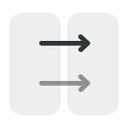
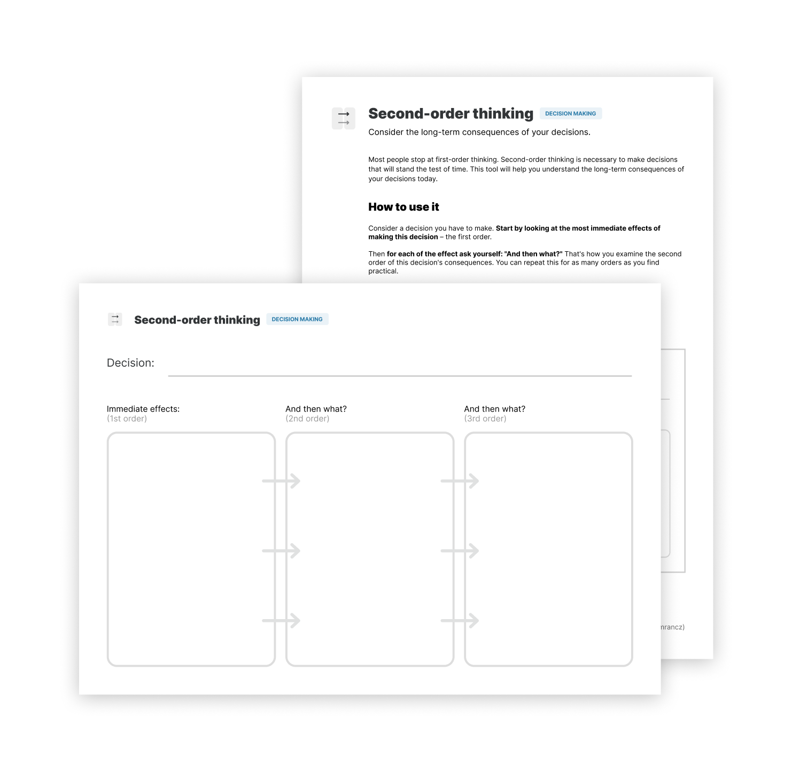

## 核心理解

在直接结果之后继续问“然后会怎样”，检查后续反应、激励变化和较长时间范围内的影响。

## 中文长文

考虑决策的长期后果。

有些决定一开始看起来是好事，过一段时间却变成损失。现在看似一项投资，日后可能成为负担；先前看起来正确的决定，后来也可能被证明不妥。二阶思维帮助你检查决定的长期影响。

大多数人只停留在一阶思维。要作出经得起时间考验的决定，就需要二阶思维，确保我们能够接受今天的决定带来的长期后果。

## 如何使用

二阶思维可以只在脑中推演，也可以写在纸上。

先确定需要作出的决定，查看它最直接的影响，也就是一阶后果。

然后对每个影响追问：“然后呢？”这样就能检查该决定的二阶后果。只要有实际意义，你还可以继续推演更多层次。

也可以从不同时间尺度思考决定的后果，问自己在以下时间后会怎样：

- 10 分钟？
  
- 10 个月？
  
- 10 年？
  

这样能分别考虑决定的短期、中期和长期后果。

二阶思维既可以用于买房这样的大决定，也可以用于吃一块蛋糕这样看似平常的小决定。它适用范围很广，可用于个人生活、商业决策或政策制定。

## 实践中的二阶思维

下面看一个实际例子：考虑是否在城市以外买房。

直接影响可能包括有了花园、家人有更大空间，但也会突然住到离工作地点一小时车程的地方。

接下来逐项推演更高阶的后果：

- 有花园 → 可以自己种植 → 能吃到新鲜的香草和蔬菜。
  
- 家庭空间变大 → 需要打扫的房间变多 → 杂乱的家可能带来更多压力。
  
- 工作地点相距一小时 → 需要买车 → 每天有两小时花在车里。
  

这只是一个重大决定可能产生的部分后果，但它说明二阶思维如何帮助你看到更长期的影响，从而作出信息更充分、考虑更周全的决定。

## 动手练习

作者制作了二阶思维模板（PDF 和 Miro 版本），包含操作步骤和示例。

该模板可通过 Untools Vault 获取；其中还提供 Untools 的高级模板和每月专题内容。

模板预览：

### 来源

[Shane Parrish，《二阶思维》](https://fs.blog/2016/04/second-order-thinking/)

[Howard Marks，《最重要的事》](https://www.goodreads.com/book/show/10454418-the-most-important-thing)

---

## 核实补充：定义、应用与边界

在直接结果之后继续问“然后会怎样”，检查后续反应、激励变化和较长时间范围内的影响。

把因果链画短而具体，标出每一步依赖的假设和可能时滞，再检查可观察证据。Howard Marks 的“第二层思维”着重比较投资判断与市场共识，和二阶后果推演有交集，但不是同一个定义。

## 如何应用

1. 列出直接后果与受影响对象。
   
2. 推演少量关键后续反应并标注条件。
   
3. 检查证据、时滞与可监测信号。
   

## 一个例子

说明性示例：放宽收录条件能增加条目，但也可能增加重复与维护成本；先小批试行并观察检索质量。

## 使用边界

链条越长，不确定性通常越大，不应把推演写成预言。

不要为了无限追问而拖延可逆决定。

## 出处与延伸阅读

- [Untools — Second-order thinking](https://untools.co/second-order-thinking/)
  
- [Howard Marks (2022), I Beg to Differ](https://www.oaktreecapital.com/docs/default-source/memos/i-beg-to-differ.pdf)
  

# 回想：直接受影响者接下来会怎样回应？

## 名称

二阶思维

## 参考链接

https://untools\.co/second\-order\-thinking/

## 适用情境

一个方案眼前收益明显，但后续影响还不清楚时使用。它帮助你沿着直接后果继续追问各方反应和长期变化，标出推演条件、时滞与需要观察的信号。

## 自问

- 直接受影响者接下来会怎样回应？
  
- 后续结果依赖哪些未经检验的假设？
  

## 例子

- 说明性示例：放宽收录条件能增加条目，但也可能增加重复与维护成本；先小批试行并观察检索质量。
  

## 边界

- 链条越长，不确定性通常越大，不应把推演写成预言。
  
- 不要为了无限追问而拖延可逆决定。
  

## 行动步骤

- 列出直接后果与受影响对象。
  
- 推演少量关键后续反应并标注条件。
  
- 检查证据、时滞与可监测信号。
  

## 使用提示

应用时：列出直接后果与受影响对象。 推演少量关键后续反应并标注条件。 检查证据、时滞与可监测信号。 链条越长，不确定性通常越大，不应把推演写成预言。

## 出处

Untools — Second\-order thinking — https://untools\.co/second\-order\-thinking/
Howard Marks \(2022\), I Beg to Differ — https://www\.oaktreecapital\.com/docs/default\-source/memos/i\-beg\-to\-differ\.pdf

## 相关卡片

[海勒姆定律](../../%E5%B7%A5%E7%A8%8B%E5%AD%A6/hyrums-law/article.md) · 常一起使用：改变可观察行为前，推演使用者依赖和迁移后的影响。

[古德哈特定律](../../%E7%AE%A1%E7%90%86%E5%AD%A6%E4%B8%8E%E5%95%86%E4%B8%9A/goodharts-law/article.md) · 相关：指标激励可能改变后续行为，需检查短期数字之外的结果。

[逆向思考](../inversion/article.md) · 常一起使用：分别检查失败路径与后续连锁反应，显式记录假设。

## 二阶效应 · 模型补充

### 适用情境

一条规定眼下奏效，需要判断人们适应它以后会发生什么。

### 原理与用法

措施先改变眼前结果，随后人们会对新规则作出反应，反应又改变最终效果。把“直接变化→谁调整行为→下一轮谁承担结果”画出来，给每个箭头写一个可观察指标。

### 编辑示例与边界

提高客服结单奖励，第一周积压下降，随后同一问题可能被拆成多张单。跟踪重复来电率和真正解决所需天数，才能判断净效果。推演越远不确定性越大，先验证最有影响的反应。

### 参考资料

邦比快跑《Munger Models》，第6章《二阶效应》。

## 相关模型

- 二阶效应的核心传导机制之一，正[反馈环](../../%E7%89%A9%E7%90%86%E5%AD%A6%E4%B8%8E%E5%8C%96%E5%AD%A6/feedback-loops/article.md)放大效应，负反馈环抑制效应。
  
- [涌现性](../../%E5%A4%8D%E6%9D%82%E7%B3%BB%E7%BB%9F%E4%B8%8E%E5%86%B3%E7%AD%96%E7%A7%91%E5%AD%A6/emergence/article.md) — 多人的后续反应若相互作用，可能形成单个行动没有的群体模式，例如司机相继减速产生向后传播的拥堵波。
  
- [激励机制](../../%E5%BE%AE%E8%A7%82%E7%BB%8F%E6%B5%8E%E5%AD%A6/incentives-economic-view/article.md) — 若新规则改变了收益分配，参与者可能调整行为，这种调整会成为政策的第二层后果。
  
- [双轨分析](../two-track-analysis/article.md) — 推演下一轮反应时，分别检查参与者实际面对的成本收益，以及从众、恐惧等可能影响其选择的因素。
  
- [安全边际](../../%E6%8A%95%E8%B5%84%E5%AD%A6%E4%B8%8E%E9%87%91%E8%9E%8D%E5%AD%A6/margin-of-safety/article.md) — 二阶后果难以精确预测时，可用若干情景测算需要多少缓冲，尤其关注无法靠单一余量吸收的风险。
  
- [概率思维与期望值](../../%E6%95%B0%E5%AD%A6%E4%B8%8E%E7%BB%9F%E8%AE%A1%E5%AD%A6/probabilistic-thinking-expected-value/article.md) — 二阶效应往往是概率性的，需要用期望值而非确定性来评估。
  
- [跨学科思维](../multidisciplinary-approach/article.md) — 价格政策可能先改变商家收益，再改变顾客习惯；结合经济与行为证据有助于追踪这类跨领域后果。
  
- [延迟效应](../../%E5%A4%8D%E6%9D%82%E7%B3%BB%E7%BB%9F%E4%B8%8E%E5%86%B3%E7%AD%96%E7%A7%91%E5%AD%A6/delay-effects/article.md) — 二阶效应常以延迟形式出现：行动与后果之间的时间差容易让人忽视因果关系。
