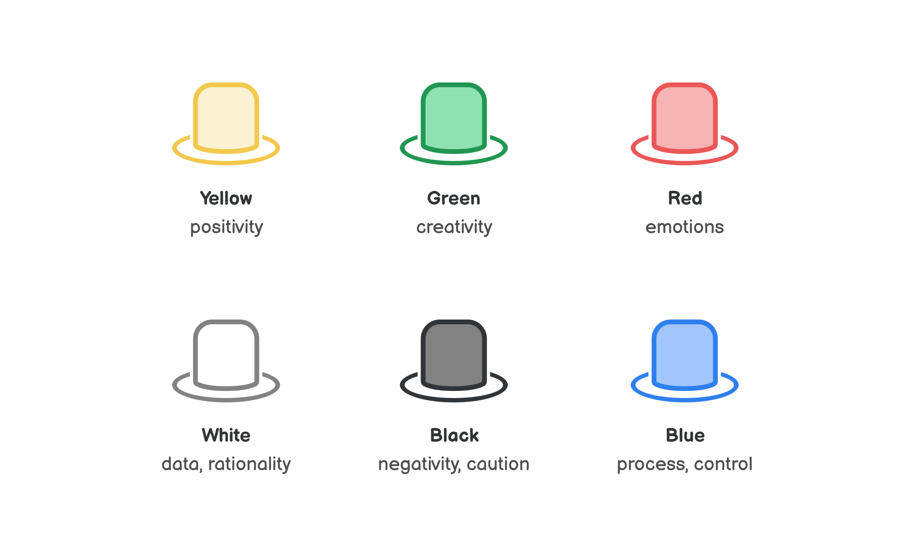
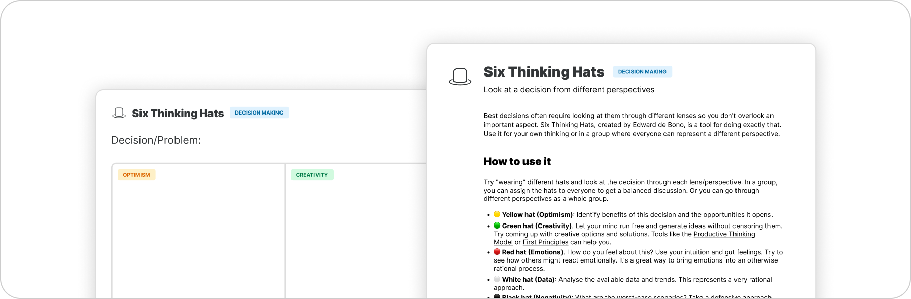

## 核心理解

按信息、感受、风险、价值、创意和过程管理六种思考功能组织讨论，让参与者在同一时段聚焦同一类问题。

## 中文长文

从不同视角看待决策。

作出好的决策，通常需要从不同角度审视问题，以免遗漏重要方面。Edward de Bono 提出的六顶思考帽正是为此设计的工具。你可以独自使用，也可以在团队中让不同成员代表不同视角。

## 如何使用

每顶思考帽都代表一种视角或思考方式。试着“戴上”不同的帽子，分别从各个角度审视决策。

在团队中，可以让不同成员各戴一顶帽子，促进讨论平衡；也可以由全体成员依次切换思考视角。

六顶帽子分别代表：

- **🟡 黄帽**代表**积极面**。寻找这个决定的好处，以及它带来的机会。
  
- **🟢 绿帽**代表**创造力**。自由地产生想法，暂时不加评判，提出有创意的选项和方案。[高效思维模型](https://untools.co/productive-thinking-model)或[第一性原理](https://untools.co/first-principles)等工具可以提供帮助。
  
- **🔴 红帽**代表**情绪**。你有什么感受？使用直觉和情绪判断，也试着理解他人可能有什么感受。它能为以理性分析为主的讨论引入情绪视角。
  
- **⚪️ 白帽**让你聚焦**数据**。分析现有资料和趋势，采用较为理性的视角。
  
- **⚫️ 黑帽**代表审视**风险与不足**。设想最坏情况，采取防御性视角，寻找可能行不通的部分。[逆向思考](https://untools.co/inversion)可以提供帮助。
  
- **🔵 蓝帽**负责管理**思考过程**。尤其在会议停滞不前时，可以推动讨论继续，例如建议大家换一顶帽子或切换讨论视角。
  ​
  

## 示例

假设管理团队正在开会，讨论是否推出一款新产品以应对销售下滑。你们使用六顶思考帽，确保从多个角度审视这个决定。

先戴黄帽，讨论新产品可能服务的市场规模。这是一个获取可观收入的机会。

接着戴黑帽，考虑潜在风险：新产品会不会侵蚀现有产品的销量？它的价值是否足以让人购买？

一位成员戴上白帽，指出市场数据揭示了几项尚未满足的需求。现有产品销售下滑也显示，整个市场可能正在转向其他解决方案。

再次戴上黄帽后，团队发现市场未满足的需求带来明确机会，而且有数据支持。考虑到潜在风险，你们接着问：“我们可以怎样确保新产品提供足够的价值？”

然后戴上绿帽，提出为新产品制作原型并让用户验证价值的想法。

由于会议已持续一段时间，戴蓝帽的主持人建议暂缓决定，等用户验证新产品后再作决定。

最后，全体成员戴上红帽，检查大家对这个计划的感受。大家认为这是一个影响重大的决定，先降低风险再作决定让人感觉更稳妥，焦虑也有所减轻。

在这个例子中，团队通过讨论不同视角，找到了一个合理的下一步。六顶思考帽让每种视角都得到表达，并促成了最终方案。

## 动手练习

作者制作了六顶思考帽模板（PDF 和 Miro 版本），包含步骤说明和示例。

该模板可通过 Untools Vault 获取；其中还提供 Untools 的高级模板和每月专题内容。

## 要点

六顶思考帽帮助你从不同角度考虑决定或问题，有意识地检查平常容易遗漏的方面，让最终决定更周全、更有韧性。

如果想进一步了解六顶思考帽，可以阅读 Edward de Bono 的同名著作。

### 来源

[Edward de Bono，《六顶思考帽》](https://www.goodreads.com/book/show/97030.Six_Thinking_Hats)

---

## 核实补充：定义、应用与边界

按信息、感受、风险、价值、创意和过程管理六种思考功能组织讨论，让参与者在同一时段聚焦同一类问题。

白帽看信息，红帽表达感受，黑帽检查风险，黄帽探索价值，绿帽生成想法，蓝帽管理过程。可以按任务选择顺序，成员共同切换视角。它是讨论组织方法，不能替代事实调查或专业决策。

## 如何应用

1. 用蓝帽明确问题、时间和产出。
   
2. 按需要依次聚焦各类思考并记录。
   
3. 汇总证据、待查事项和下一步。
   

## 一个例子

说明性示例：讨论知识导入时先列字段事实，再表达担忧、检查失败风险、寻找收益与替代方案，最后决定验证步骤。

## 使用边界

不把颜色贴成成员的固定性格。

不同观点并非都同样符合事实，讨论结束仍需证据评价。

## 出处与延伸阅读

- [The de Bono Group — Six Thinking Hats](https://www.debonogroup.com/services/core-programs/six-thinking-hats/)
  
- [Untools — Six Thinking Hats](https://untools.co/six-thinking-hats/)
  

# 回想：当前在讨论哪一种问题？

## 名称

六顶思考帽

## 参考链接

https://www\.debonogroup\.com/services/core\-programs/six\-thinking\-hats/

## 适用情境

团队讨论把事实、情绪、风险和创意混在一起，或需要从多个角度审视方案时使用。它帮助你安排不同的思考视角，整理各类意见，再汇总证据、待查事项和下一步。

## 自问

- 当前在讨论哪一种问题？
  
- 是否把事实、感受与预测混在一起？
  

## 例子

- 说明性示例：讨论知识导入时先列字段事实，再表达担忧、检查失败风险、寻找收益与替代方案，最后决定验证步骤。
  

## 边界

- 不把颜色贴成成员的固定性格。
  
- 不同观点并非都同样符合事实，讨论结束仍需证据评价。
  

## 行动步骤

- 用蓝帽明确问题、时间和产出。
  
- 按需要依次聚焦各类思考并记录。
  
- 汇总证据、待查事项和下一步。
  

## 使用提示

应用时：用蓝帽明确问题、时间和产出。 按需要依次聚焦各类思考并记录。 汇总证据、待查事项和下一步。 不把颜色贴成成员的固定性格。

## 出处

The de Bono Group — Six Thinking Hats — https://www\.debonogroup\.com/services/core\-programs/six\-thinking\-hats/
Untools — Six Thinking Hats — https://untools\.co/six\-thinking\-hats/

## 相关卡片

[分析瘫痪](../../%E5%BF%83%E7%90%86%E5%AD%A6/analysis-paralysis/article.md) · 相关：讨论模式和收口条件可帮助将无序争论转成明确下一步。
