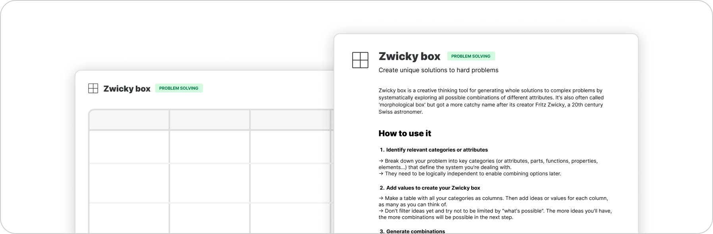

## 核心理解

把复杂问题拆成相对独立的属性，为每个属性列出多个取值，再组合探索完整方案。

## 中文长文

为复杂问题生成独特方案。

为复杂问题产生想法并不容易。我们常常直接采用熟悉的方案，或漏掉问题中的某些因素。复杂问题需要的不只是传统头脑风暴；这时，系统化的方法就能派上用场——茨维基盒就是这样一种方法。

茨维基盒是一种**通过系统探索不同属性的各种组合，为复杂问题生成完整方案的创造性思维工具**。它也常称为“形态盒”（morphological box），后来以其创造者、20 世纪瑞士天文学家 Fritz Zwicky 的名字获得更醒目的名称。

除了在科学领域的多项贡献（例如发现暗物质或中子星），Zwicky 还运用分解和强制联想这两个创造力原则，开发了这种方法来解决复杂问题。

## 如何使用

茨维基盒适用于有多个维度的复杂问题，或需要生成大量创意方案的情境。在团队中使用尤其有效，因为不同成员可以为各个类别贡献想法。

开始前，先清楚定义要解决的问题，然后按以下步骤操作：

#### 1. 找出相关类别或属性

这是最关键的一步。把问题拆分成定义该系统的关键类别（也可以是属性、部分、功能、特性、要素等）。这些类别在逻辑上应尽量相互独立，方便之后组合选项。

寻找属性的一个办法是观察现有案例，列出它的部分或组成元素，再反向推断有哪些属性。

例如，设计一款新应用时，可以考虑目标用户、核心功能、独特特性、交付方式和盈利模式。

#### 2. 填入取值，建立茨维基盒

制作一张表格，把各类别作为列，并在每列下尽可能多地添加想法或取值。

暂时不要筛选想法，也不要被“现实中能不能做到”限制。想法越多，下一步能探索的组合就越多。

例如，设计新应用时，“盈利模式”一栏可以包含订阅、一次性购买、应用内广告、用户自定价格或赞助。

#### 3. 生成组合

填好茨维基盒后，就可以开始生成组合。

从每一列选一个取值，组成一个完整方案。你可以系统地遍历所有组合、随机挑选，也可以聚焦某些选项或属性。

要留出足够时间并保持开放心态。即使某些组合一开始看起来奇怪，也可能激发创新想法。

## 示例：重新设计反馈系统

再用一个例子说明茨维基盒。假设你想改进应用收集客户反馈的方式。

首先找出相关属性：收集方式、时间、反馈形式、激励和分析方法。

接着用这些属性建立茨维基盒：

|**收集方式**|**时间**|**形式**|**激励**|**分析方式**|
| --------------| ------------| ------------| ----------| --------------|
|邮件调查|用户取消时|开放文本|礼品卡|AI 情感分析|
|应用内弹窗|购买后|单选题|折扣码|人工审核|
|电话访谈|持续进行|语音留言|提前体验|趋势分析|
|社交媒体|使用期间|结构化表单|公开致谢|团队讨论|

现在可以开始寻找并评估不同方案。例如：

- **组合 A：**电话访谈 + 每周安排 + 语音留言 + 提前体验 + AI 情感分析。
  
  - 每周安排电话，邀请客户留言描述使用体验，并以新功能的提前体验作为激励，再用 AI 分析情绪趋势。
    
  
- **组合 B：**社交聆听 + 使用期间 + 视频反馈 + 公开致谢 + 团队讨论。
  
  - 监测社交媒体上关于产品的讨论；当用户在使用产品时提到体验，就公开感谢他们并邀请他们录制视频反馈，供团队讨论。
    
  

并非所有组合都有意义，但有些组合会激发你在传统头脑风暴中未必想到或表达的点子。

## 什么时候使用茨维基盒

这种方法最适合：

- 有多个维度的复杂问题；
  
- 需要产生新想法的创新挑战；
  
- 需要探索多个设计方向的产品开发。
  

除了复杂的工作问题，拿它来尝试设计一种新三明治也可以很有趣。

## 动手练习

作者制作了茨维基盒模板（PDF 和 Miro 版本），包含操作步骤和示例。

该模板可通过 Untools Vault 获取；其中还提供 Untools 的高级模板和每月专题内容。

### 要点

前面提到，茨维基盒适用于简单头脑风暴难以应对的复杂问题。它能产生大量不同的方案组合，因此也适合用系统方法“跳出框框”思考。

想要充分发挥它的作用，应聚焦最相关的属性，并探索足够多的组合，即使其中某些组合看起来有些奇怪。

最终，茨维基盒只会给你大量原始想法，仍需要你进一步完善，才能形成真正可行的方案。

### 来源

[Fabian Post，《形态盒》](https://fabianpost.com/morphological-box/)

[Every.to，《用茨维基盒以意想不到的方式解决难题》](https://every.to/superorganizers/use-a-zwicky-box-to-solve-hard-problems-399122)

# 回想：这个问题由哪些关键属性构成？

## 名称

茨维基盒

## 适用情境

面对包含多个维度的复杂问题，或头脑风暴总是回到熟悉方案时使用。它帮助你拆出关键属性、列出各自选项，再通过组合产生可进一步筛选的完整方案。

## 自问

- 这个问题由哪些关键属性构成？
  
- 每个属性有哪些可能取值？
  
- 不同取值组合后会形成什么完整方案？
  
- 哪些组合值得进一步评估？
  

## 例子

- 改进客户反馈系统时，可组合收集方式、时间、反馈形式、激励方式和分析方法，形成新的反馈方案。
  

## 边界

- 属性之间高度依赖、难以独立组合时
  
- 组合数量过大却没有筛选或验证步骤时
  

## 行动步骤

- 清楚定义待解决的问题
  
- 拆出逻辑上相对独立的属性
  
- 为每个属性尽可能多地列出取值
  
- 从每列选择一个取值组成方案
  
- 系统、随机或定向探索组合
  
- 评估并筛选可行方案
  

## 使用提示

引导用户先把问题拆成相对独立的属性，再为每项属性扩展多个取值并通过组合生成方案。鼓励先发散，不急着过滤；随后筛选组合并验证可行性，避免把生成的原始点子当成已验证方案。

## 出处

Untools，《Zwicky box》：https://untools\.co/zwicky\-box/。文章还引用 Fabian Post 和 Every\.to；中文内容据本地英文原文翻译。
