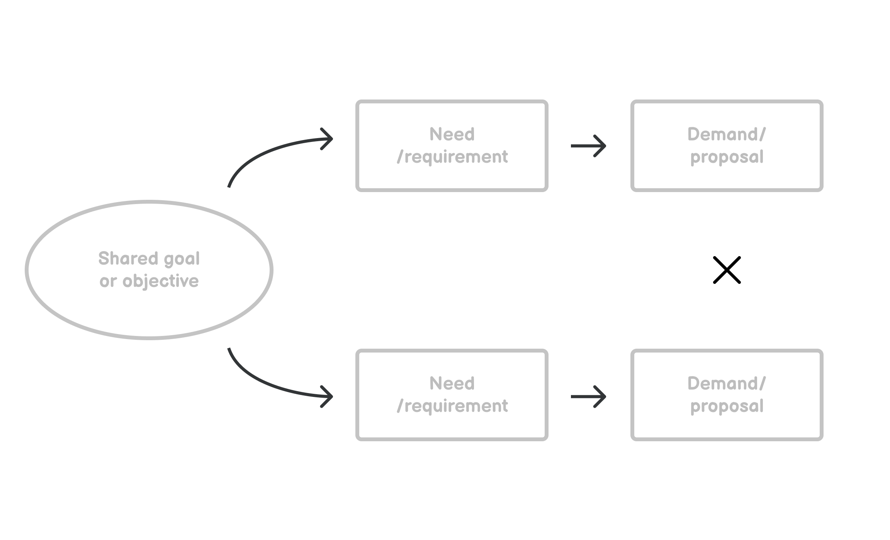
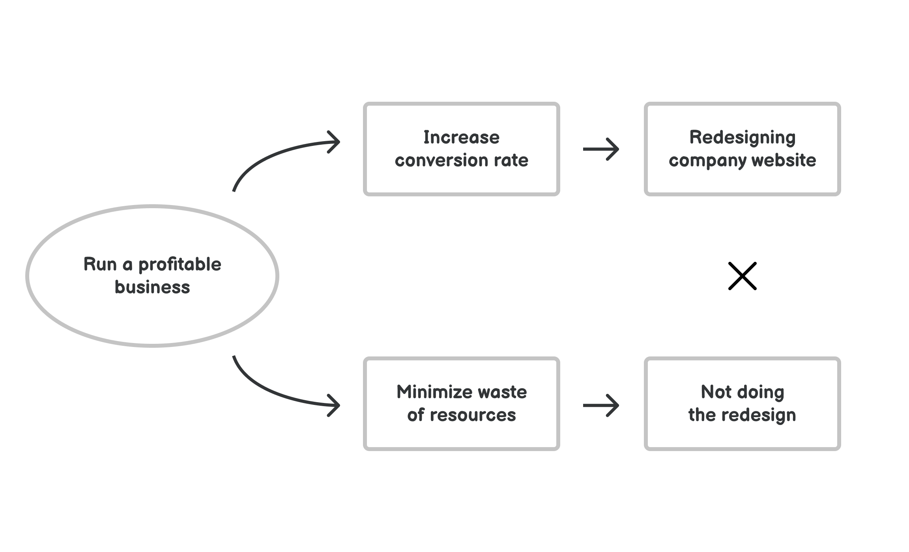
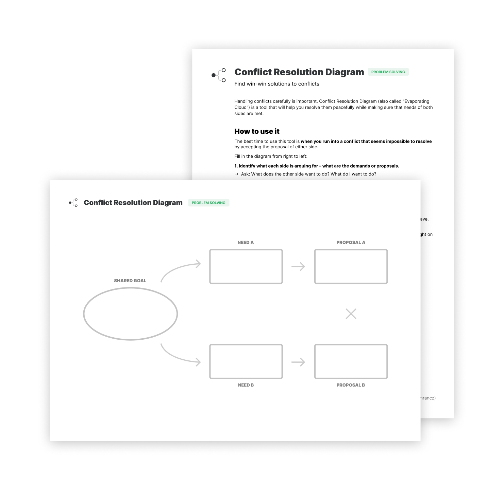

## 核心理解

从冲突双方的主张倒推各自需求与共同目标，再寻找同时满足双方需求的双赢方案。

## 中文长文

为冲突寻找双赢方案。

谨慎处理冲突很重要。冲突解决图（也称“蒸发云”）帮助双方和平地化解冲突，同时确保双方的需求都得到满足。

这是 Eliyahu Goldratt 在约束理论中提出的一种思考工具。下面看看它如何运作。

## 如何使用

当你遇到似乎无法通过接受任一方提议来解决的冲突时，适合使用这个工具。冲突可以发生在他人之间，也可以发生在自己内心；可以涉及工作，也可以涉及个人生活。你可以在白板或纸上画出图，也可以在脑中完成梳理。

图由三部分组成：

- 冲突双方各自的要求或主张：它们通常相互排斥，因而形成冲突。
  
- 双方各自深层的需求或要求。
  
- 支撑这些需求的共同目标。
  ​
  

梳理时要反向推导，也就是从右向左：

1. 找出双方各自坚持什么——各自的要求或提议是什么？
   
   - 可以问：“对方想怎么做？我想怎么做？”
     
   
2. 明确各方立场背后的需求。
   
   - 可以问：“双方的提议分别满足了什么需求？”
     
   
3. 找到共同目标。
   
   - 可以问：“满足双方需求后，能够实现什么目标？”
     
   - 这是最关键的一步。双方通常都想实现更高层次的某个目标，只是对如何实现有不同看法。要确认双方是在共同努力实现这个目标。
     
   

找到共同目标，是提出双赢方案的必要条件。

接着讨论原始提议背后的假设。这通常能揭示双方方案为何看起来互不相容。

之后就可以提出新方案：以共同目标和满足双方需求为重点。

这样冲突就有机会得到解决：

1. 通过寻找双方的共同点，和平地处理冲突。
   
2. 通过合作寻找双赢方案，朝共同目标推进。
   

## 示例

假设你和同事正在讨论是否重新设计产品网站。你反对这个项目，而同事积极推动。你们已经讨论了一个小时，仍没有结论。为了继续推进，你提议画一张冲突解决图。

首先写下双方的主张：重做网站与不重做网站。

然后通过讨论各方案为何更好，找出背后的需求。你发现，同事希望提升网站转化率；你反对项目，是因为希望避免资源浪费，并认为如此大型的项目风险很高。

最后，你们共同寻找能同时满足这些需求的目标，发现双方都希望实现公司的财务目标。共同目标就是让公司保持盈利。

现在你们有了共同的出发点。围绕共同点协作，就能化解冲突并提出兼顾目标与双方需求的方案，例如针对网站开展小规模实验，在减少资源投入的同时，尝试提升转化率。

这是一个简化示例，但展示了冲突解决图的主要价值：帮助双方找到双赢方案。

## 动手练习

作者制作了冲突解决图的模板（PDF 和 Miro 版本），包含操作步骤和示例。

该模板可通过 Untools Vault 获取；其中还提供 Untools 的高级模板和每月专题内容。

模板预览：

### 来源

[H. William Dettmer，《逻辑思维流程》](https://www.goodreads.com/book/show/2147388.The_Logical_Thinking_Process)

[Forte Labs Blog，《逻辑思维流程的朋克策略指南》](https://fortelabs.co/blog/the-punk-strategy-guide-to-the-logical-thinking-process/)

# 回想：双方分别主张什么？

## 名称

冲突解决图

## 适用情境

双方坚持看似互斥的方案，讨论又停在立场争执上时使用。它帮助你梳理各自的主张、深层需求和共同目标，检查其中的假设，寻找兼顾双方需求的替代方案。

## 自问

- 双方分别主张什么？
  
- 每个主张要满足什么需求？
  
- 满足双方需求能共同实现什么目标？
  
- 哪些假设让双方的方案显得互斥？
  

## 例子

- 讨论是否重做产品网站时，一方关注转化率，另一方担心资源浪费；双方确认共同目标是实现公司财务目标后，可用小范围实验同时验证转化并控制投入。
  

## 边界

- 冲突双方尚无法安全、坦诚地表达各自需求时
  

## 行动步骤

- 写下双方各自主张
  
- 追问每个主张背后的需求
  
- 找出满足这些需求所服务的共同目标
  
- 检视造成方案互斥的假设
  
- 围绕共同目标设计兼顾双方需求的新方案
  

## 使用提示

不要急着裁定哪一方正确。先按“主张—需求—共同目标”从右向左梳理，再检视造成冲突的假设，并提出能同时服务共同目标与双方需求的可行方案。

## 出处

Untools，《Conflict Resolution Diagram》：https://untools\.co/conflict\-resolution\-diagram/。文章将其称为 Evaporating Cloud；中文内容据本地英文原文翻译。
