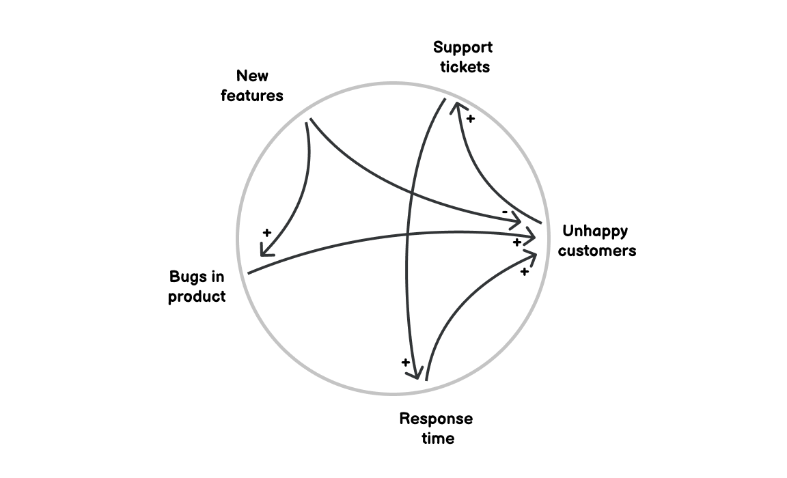
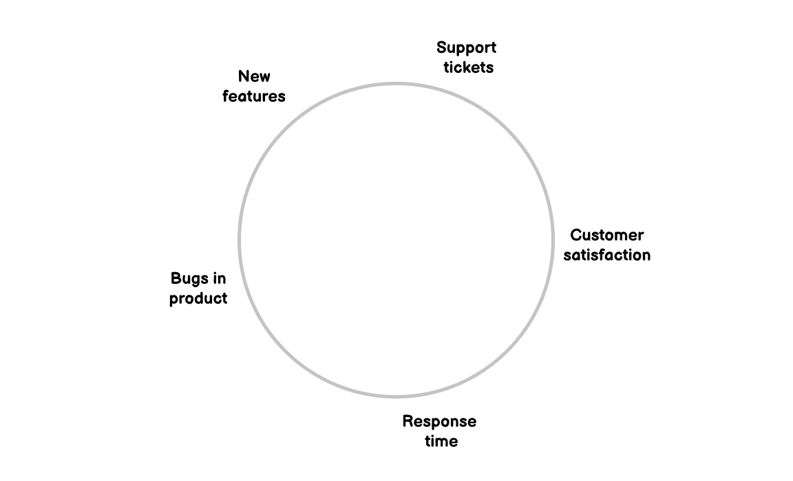
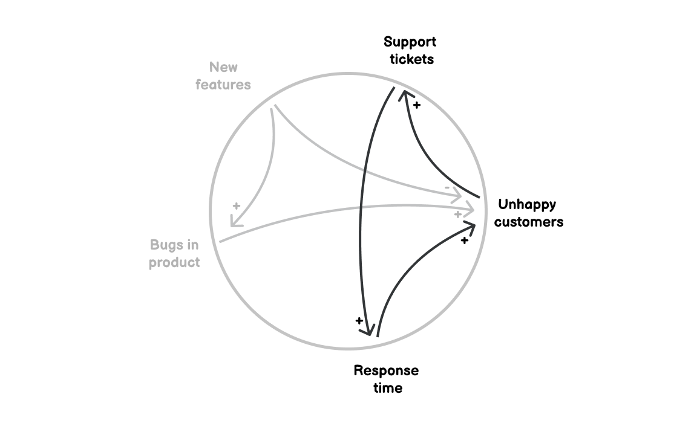
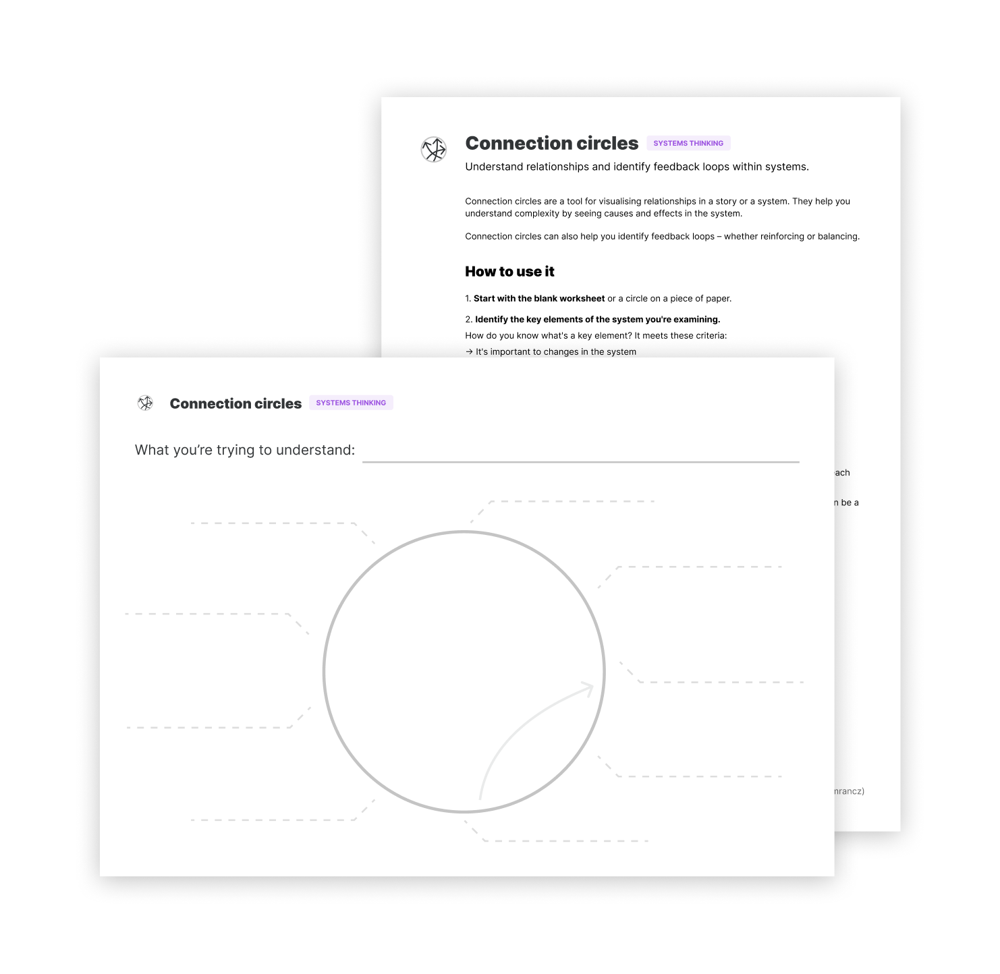

## 核心理解

把系统中的关键要素及其因果影响画在圆环上，帮助看清关系并识别强化或平衡反馈回路。

## 中文长文

理解系统中的关系并识别反馈回路。

连接圆圈是一种把故事或系统中的关系可视化的工具。通过呈现系统中的因果关系，它帮助我们理解复杂性。

连接圆圈也可以帮助识别反馈回路，包括[强化回路](https://untools.co/reinforcing-feedback-loop/)和[平衡回路](https://untools.co/balancing-feedback-loop/)。

上图展示了连接圆圈的一种样子。具体该如何绘制？

## 如何绘制连接圆圈

1. 先在纸上画一个圆。
   
2. 找出你正在研究的系统中的关键要素。
   什么样的要素算关键？它需要符合以下条件：
   
   - 它对系统中的变化很重要；
     
   - 它在系统中会增加或减少；
     
   - 它可以用名词来描述。
     
   
3. 把这些要素写在圆周上（不要超过 10 个）。
   
4. 寻找因果关系。
   
   1. 哪些要素会直接导致其他要素增加或减少？
      
   2. 在这些要素之间画箭头。
      
   3. 在每条关系的终点要素旁用“+”或“−”标明它会增加还是减少。
      
   
5. 找出所有因果关系。它们可以有数据依据，也可以先作为假设。
   
6. 寻找关系形成闭合回路的要素组合。这些就是反馈回路。
   

## 示例

用一个例子说明会更清楚。假设我们的产品正在面对客户不满。我们知道，客户在抱怨产品缺陷过多、客服响应太慢（因为客户提交了更多支持工单）。与此同时，我们不断推出新功能，希望让客户更满意。我们可以画一个连接圆圈来理解这些情况。

从这段描述中，可以找出几个关键要素：不满的客户、产品缺陷、响应时间、支持工单和新功能。把它们写在连接圆圈周围：

接下来记录要素间的关系。例如，不满的客户会提交更多支持工单。工单增加会延长响应时间，而响应变慢又会让更多客户不满。我们尝试推出新功能来减少客户不满，但新功能也会带来更多缺陷，进而让客户更加不满。现在把这些关系画到连接圆圈中：

连接圆圈现在清楚呈现了系统中的关键要素及其关系。我们还能看到一个反馈回路：

完成的连接圆圈及其反馈回路有助于我们更好地理解系统，也能帮助我们判断需要作出哪些改变。

## 要点

连接圆圈是理解系统的实用工具。关键步骤是识别少数关键要素，并映射它们之间的关系。它也可以帮助你发现反馈回路。

## 动手练习

作者制作了连接圆圈模板（PDF 和 Miro 版本），包含操作步骤和示例。

该模板可通过 Untools Vault 获取；其中还提供 Untools 的高级模板和每月专题内容。

模板预览：

### 来源

[Systems Thinker，《了解连接圆圈》](https://thesystemsthinker.com/learning-about-connection-circles/)

# 回想：哪些要素会增加或减少？

## 名称

连接圆圈

## 适用情境

系统中多个因素相互影响，难以看清变化是怎样传递时使用。它帮助你列出关键变量、画出有方向的影响关系，识别可能的反馈回路，并与团队核对理解。

## 自问

- 哪些要素会增加或减少？
  
- 一个要素如何影响另一个要素？
  
- 这些影响是否形成闭环？
  
- 关系方向有数据支持还是只是待验证的假设？
  

## 例子

- 梳理产品中的不满客户、缺陷、客服响应时间、支持工单和新功能之间的因果关系，发现工单增加会拉长响应时间并进一步增加客户不满。
  

## 边界

- 变量或因果方向尚不清楚，却把假设误当成已验证事实时
  

## 行动步骤

- 在纸上画一个圆
  
- 选出不超过 10 个会变化且可用名词表达的关键要素
  
- 将要素写在圆周上
  
- 用箭头标出直接因果影响，并用加号或减号表示影响方向
  
- 标记哪些关系有数据依据、哪些是假设
  
- 找出形成闭环的关系并判断反馈类型
  

## 使用提示

协助用户先选出少量关键变量，再逐条连接直接因果关系，标出影响方向和证据状态；最后检查是否形成反馈闭环，并区分强化与平衡回路。

## 出处

Untools，《Connection circles》：https://untools\.co/connection\-circles/。中文内容据本地英文原文翻译。
