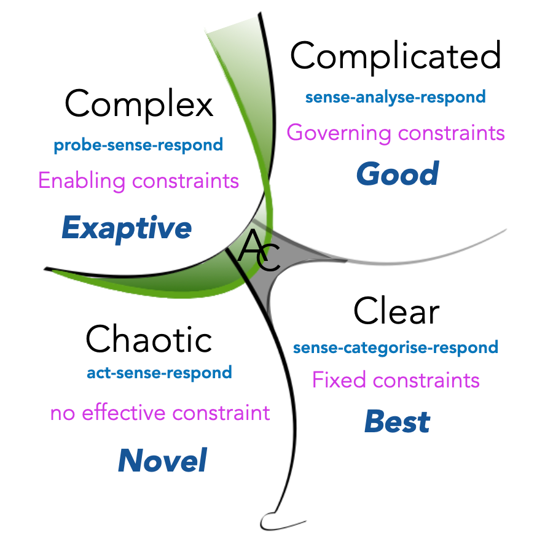

## 核心理解

先判断问题所处的情境领域，再采用与因果关系清晰度和可预测性相匹配的应对方式。

## 中文长文

理解不同情境，并选择合适的应对方式。

不同情境通常需要不同的应对方式。Cynefin 框架（发音为 /kəˈnɛvɪn/，近似“kuh-nev-in”）帮助你理解当前面对的情境，并针对所处情境作出合适的决定。该框架由 Dave Snowden 于 1999 年提出。

## 如何使用

该框架把问题或情境分为五个领域：清晰、繁杂、复杂、混乱和失序。

核心做法是：**先判断自己处于哪个领域，再根据该领域的特点选择行动。**下面逐一介绍各领域。

### 清晰

也称为显而易见或简单领域，适用于采用最佳实践的情境。问题熟悉且定义明确，因果关系清楚，情况稳定。许多流程类情境和问题属于这一领域。这里涉及的是“已知的已知”。

这类情境通常有明确的解决办法，也不需要太多专业知识。

适合的做法是“感知—分类—响应”：先了解情境（感知），然后归类，再应用最佳实践作出响应。

### 繁杂

在这个领域中，可能存在多个正确答案，但它们不会立刻显现。这里属于“已知的未知”：问题是什么是清楚的，但找到答案需要投入分析。

因此，适合采用“感知—分析—响应”。由于需要分析，这类情境通常需要专业知识。专家应评估情境、调查可能选项并选择行动方案。

### 复杂

这个领域存在“未知的未知”。我们无法仅靠分析理解情境，因为对问题了解不足，甚至还不清楚应该先回答什么问题。

合适的做法是先进行试验，从问题中学习；再感知当前情况并作出响应。目标是逐步了解足够的信息，让情境转入较容易处理的繁杂领域。

### 混乱

当局势失控时，就属于混乱领域，因果关系也不清楚。此时要先采取行动建立一定的稳定、控制局势；之后再评估情况，逐步形成足够的秩序，让情境转入复杂领域。行动顺序是“行动—感知—响应”。

混乱情境也可能带来尝试新方案的机会，因为人在这种环境下可能更愿意接受创新做法。

### 失序

如果你还不知道自己处于什么领域，就处于失序状态。目标应是尽快判断正确领域并继续处理。把问题拆成多个部分、分别归入不同领域，有时会有帮助。

## 判断所处领域

熟悉各领域的特点，有助于判断某个问题或情境适用于哪个领域。下方来源可供进一步了解。

以下问题也可以帮助初步判断：

- 你知道是什么造成了当前情境吗？
  
- 当前情境处于控制之中吗？
  
- 你对它了解多少？
  
- 解决它是否需要专家知识？
  

## 要点

Cynefin 框架的核心观点是：**不同类型的问题或情境需要不同的应对方式。**先判断当前面对的情境类型，再借助该框架选择合适的响应。

### 来源

[Harvard Business Review，《领导者的决策框架》](https://hbr.org/2007/11/a-leaders-framework-for-decision-making)

[Everyday Kanban，《理解 Cynefin 框架》](https://www.everydaykanban.com/2013/09/29/understanding-the-cynefin-framework/)

[Wikipedia，《Cynefin 框架》](https://en.wikipedia.org/wiki/Cynefin_framework)

[Miro，《Cynefin 框架模板》](https://miro.com/templates/cynefin-framework/)

# 回想：因果关系是否清楚？

## 名称

Cynefin 情境框架

## 适用情境

面对陌生或不确定的问题，不清楚该沿用流程、深入分析、小步试验还是先采取行动时使用。它帮助你先辨认当前情境的因果关系和可预测程度，再选择相应的应对方式。

## 自问

- 因果关系是否清楚？
  
- 局势是否处于控制之中？
  
- 我们对问题知道多少？
  
- 判断或解决问题是否需要专家知识？
  

## 例子

- 明确且熟悉的流程问题可采用最佳实践；需要专家分析的问题先分析再响应；复杂问题先做安全试验；混乱局势先行动以建立稳定。
  

## 边界

- 把情境领域当作固定标签，或在信息不足时过早断定问题分类时
  

## 行动步骤

- 判断是否能识别当前情境及因果关系
  
- 将情境归入清晰、繁杂、复杂、混乱或失序领域
  
- 分别采用感知—分类—响应、感知—分析—响应、探查—感知—响应或行动—感知—响应
  
- 持续观察情境变化并重新判断
  

## 使用提示

先依据因果关系是否清晰、局势是否可控、现有知识和专家需求判断情境；再解释对应领域及适当行动顺序。对失序或不确定的情况，先拆分问题并继续收集信息，不要假装分类具有确定性。

## 出处

Untools，《Cynefin framework》：https://untools\.co/cynefin\-framework/。开发者为 Dave Snowden；中文内容据本地英文原文翻译。
