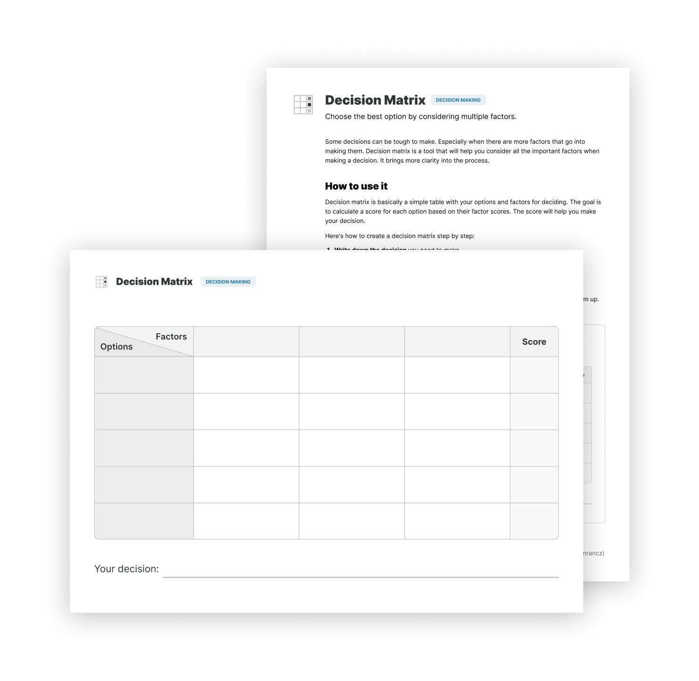

## 核心理解

列出备选方案和决策因素，为因素设置权重并给方案评分，用结构化比较辅助选择。

## 中文长文

综合多个因素，选择更合适的方案。

有些决定并不容易，尤其是需要考虑很多因素时。决策矩阵帮助你同时纳入重要因素，让决策过程更清晰。

当你有多个备选方案，需要根据多个不同因素作出选择时，这个工具尤其有用。

## 如何使用

决策矩阵本质上是一张列出选项和决策因素的简单表格。目标是根据各方案在不同因素上的得分计算总分，并用总分辅助决策。

可以按以下步骤创建决策矩阵：

1. 写下需要作出的决定。
   
2. 列出备选方案。
   
3. 找出需要考虑的因素。
   
4. 按每个因素为各方案评分。
   
5. 为各因素设置权重。
   
6. 计算各方案的总分：每项评分乘以该因素的权重，再把结果相加。
   
7. 选择得分最高的方案。
   

下面看一个实际例子。

## 实际示例

假设你负责一个设计团队，需要决定团队使用哪款设计工具。经过初步调研，你把范围缩小到 Sketch、Figma 和 Framer。先把它们放进决策矩阵：

|**因素**|TBD|TBD|TBD|**得分**|
| ----------| -----| -----| -----| ----------|
|**权重**|||||
|Sketch|||||
|Figma|||||
|Framer|||||

接下来确定需要考虑的因素。团队有固定的软件预算，所以先考虑成本。与团队讨论后，你们认为原型制作和协作能力最重要。于是得到影响决定的几个因素。

|**因素**|成本|原型制作|协作|**得分**|
| ----------| ------| ----------| ------| ----------|
|**权重**|||||
|Sketch|||||
|Figma|||||
|Framer|||||

现在按每个因素给各方案评分。我们采用 1 到 5 分（1 最差，5 最好），你也可以使用其他刻度。

**成本**——你发现 Figma 和 Framer 每位编辑者每月都收费 12 美元，Sketch 稍便宜，为 9 美元。因此分别给前两者打 3 分，给 Sketch 打 4 分。

**原型制作**——Framer 的原型能力最强。Figma 和 Sketch 比较接近，但 Figma 能做得稍多一些。Framer 得 5 分，Figma 得 3 分，Sketch 得 2 分。

**协作**——请团队评估这一项。他们认为 Figma 最适合协作，给它 5 分；Sketch 和 Framer 都得 3 分。

把评分填入矩阵：

|**因素**|成本|原型制作|协作|**得分**|
| ----------| ------| ----------| ------| ----------|
|**权重**|||||
|Sketch|4|2|3||
|Figma|3|3|5||
|Framer|3|5|3||

此时，决策可能已经清晰一些，但各因素的重要性并不相同，因此还需要设置权重。预算已经确定，所以成本最重要，权重设为 5。团队认为原型能力比协作功能稍重要，因此按相对重要性设置其余权重：

|**因素**|成本|原型制作|协作|**得分**|
| ----------| ------| ----------| ------| ----------|
|**权重**|5|4|3||
|Sketch|4|2|3||
|Figma|3|3|5||
|Framer|3|5|3||

下一步是把每项评分乘以对应因素的权重，再将各项结果相加，得到每个方案的总分：

|**因素**|成本|原型制作|协作|**得分**|
| ----------| -----------| -----------| -----------| ----------|
|**权重**|5|4|3||
|Sketch|4×5 = 20|2×4 = 8|3×3 = 9|**37**|
|Figma|3×5 = 15|3×4 = 12|5×3 = 15|**42**|
|Framer|3×5 = 15|5×4 = 20|3×3 = 9|**44**|

这样就得到了各方案在重要因素下的总分。这个例子中，Framer 得分最高。

当需要考虑多个因素时，决策矩阵很实用。它让决策过程更清楚，也能降低不确定性和主观性，帮助你判断哪个选择更合理。

## 动手练习

作者制作了决策矩阵模板（PDF 和 Miro 版本），包含操作步骤和示例。

该模板可通过 Untools Vault 获取；其中还提供 Untools 的高级模板和每月专题内容。

模板预览：

### 来源

[Toggl Blog，《决策矩阵》](https://toggl.com/blog/decision-matrix)

# 回想：有哪些可选方案？

## 名称

决策矩阵

## 适用情境

多个备选方案需要按不同标准比较，且各标准的重要性不同时使用。它帮助你列清选项、因素、评分和权重，把选择依据放到同一张表里，便于讨论取舍。

## 自问

- 有哪些可选方案？
  
- 哪些因素影响决定？
  
- 各因素重要性如何？
  
- 评分与权重背后的依据是什么？
  

## 例子

- 团队选择设计工具时，可按成本、原型能力和协作能力给 Sketch、Figma、Framer 评分，再用权重计算加权总分。
  

## 边界

- 选项难以直接比较或评分依据过于主观时
  
- 把加权总分误当成客观真理而忽略关键限制时
  

## 行动步骤

- 写下需要作出的决定
  
- 列出备选方案和比较因素
  
- 为每个方案在各因素上评分
  
- 按相对重要性为因素设置权重
  
- 计算加权总分
  
- 结合未量化条件解释最终选择
  

## 使用提示

帮助用户明确方案、评价因素和权重依据，再计算加权分数；提醒评分与权重反映的是当前假设和判断，不要让总分掩盖无法量化的约束。

## 出处

Untools，《Decision matrix》：https://untools\.co/decision\-matrix/。文章还引用 Toggl Blog；中文内容据本地英文原文翻译。
