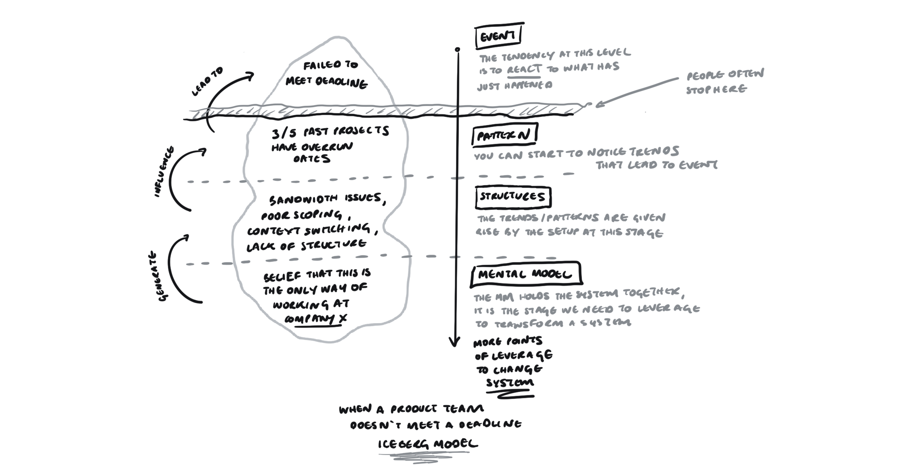
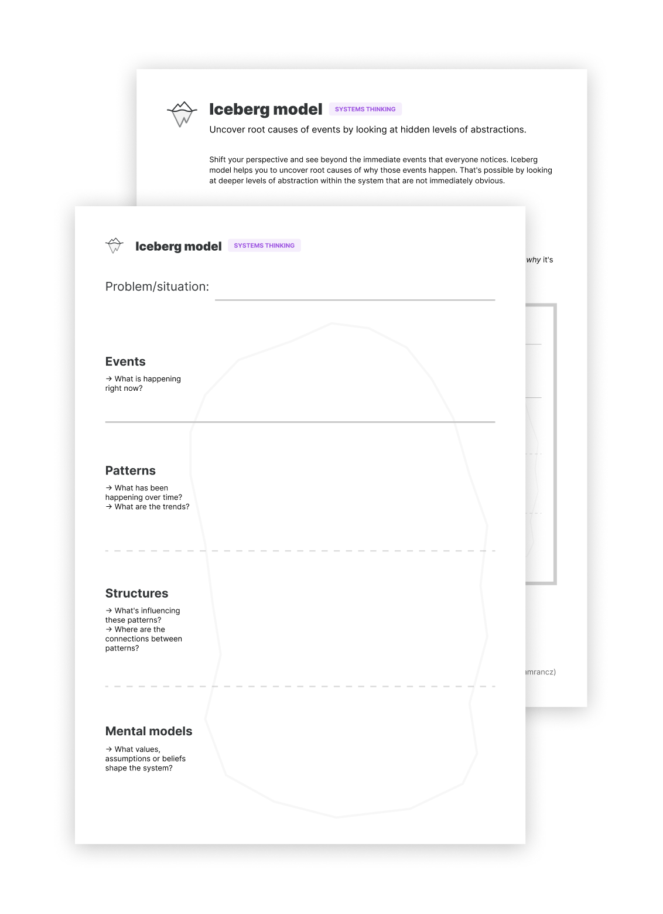

## 核心理解

从事件、模式、系统结构和心智模式四个层次向下探查，寻找表面事件背后的深层原因。

## 中文长文

从隐藏的抽象层次入手，探查事件背后的根因。

只处理事件本身往往不够。真正的原因通常藏在表面之下，不容易直接看见。

冰山模型帮助你转换视角，不只观察大家都能看到的眼前事件。它通过查看系统中更深、较不显眼的抽象层次，帮助你发现事件为何发生。

## 如何使用

冰山模型包含四个层次：

- 事件
  
- 模式
  
- 结构
  
- 心智模式
  ​
  

*Justin Farrugia 绘制的冰山模型示例*

越过单个事件向下观察，就能看到随时间变化的趋势，也就是模式。模式为我们提供线索，帮助理解其背后的系统结构。结构是系统内部的关系和反馈回路，而这些结构又建立在人们深层的心智模式之上。

事件和模式告诉你*发生了什么*；结构和心智模式帮助解释*为什么会发生*。

在冰山中探查得越深，越可能找到有影响力的干预点。

### 分析四个层次

以下问题可以帮助你理解某个问题或情境中的各个层次。

**事件：**

- 此刻正在发生什么？
  

**模式：**

- 一段时间以来发生了什么？趋势是什么？
  

**结构：**

- 什么因素影响这些模式？
  
- 这些模式之间有哪些联系？
  

**心智模式：**

- 哪些价值观、信念或假设塑造了这个系统？
  

需要注意，回答这些问题通常需要调查和深入挖掘。尤其是心智模式，它们本来就不容易记录，更难直接看见。

*Justin Farrugia 绘制的冰山模型示例*

## 示例

用一个现实案例看看冰山模型如何运作。

假设产品团队刚发布的功能出现了几个缺陷。这是一个单次事件。你可能本能地开始修复它们，但如果希望以后不再发生，单次修复显然不够。

回看一段时间后，你发现每次发布的功能都会伴随多个缺陷。这是一个模式。继续追查后发现，团队在发布前没有安排测试，质量保证只在发布后进行；团队通常还要在紧迫期限下交付功能。这些是系统结构。

再深入调查，你发现团队把按时交付看得比工作质量更重要。紧迫期限由管理者设定，而团队认为自己不应提出异议。

由此可见，超越眼前事件有助于找到问题的深层原因，也让你拥有更多解决问题的着力点。

## 动手练习

作者制作了冰山模型模板（PDF 和 Miro 版本），包含操作步骤和示例。

该模板可通过 Untools Vault 获取；其中还提供 Untools 的高级模板和每月专题内容。

模板预览：

### 来源

[Ed Cunliff，《连接系统思维与行动》](https://thesystemsthinker.com/connecting-systems-thinking-and-action/)

[Justin Farrugia，《可视化设计背后的系统》](https://uxdesign.cc/visualizing-the-systems-behind-our-designs-7a7c95b4cfb2)

# 回想：此刻发生了什么？

## 名称

冰山模型

## 适用情境

同类问题反复出现，处理单次事件仍难以改善时使用。它帮助你从眼前事件追查长期模式、系统结构和深层假设，寻找需要进一步调查或调整的地方。

## 自问

- 此刻发生了什么？
  
- 一段时间以来反复出现什么模式？
  
- 哪些系统结构在影响这些模式？
  
- 哪些价值观、信念或假设支撑着这些结构？
  

## 例子

- 产品发布后出现缺陷是单次事件；每次发布都出现多个缺陷是模式；缺乏发布前测试和紧迫期限是结构；重视按时交付胜过质量则是潜在心智模式。
  

## 边界

- 缺少历史数据却把一次事件推断成稳定模式时
  
- 把未经调查的价值观或假设当作根因事实时
  

## 行动步骤

- 记录可观察到的事件
  
- 回看时间序列并识别重复模式
  
- 追查影响模式的流程、关系和反馈结构
  
- 调查支撑结构的价值观、信念和假设
  
- 区分证据、假设和待验证解释
  

## 使用提示

带用户从事件逐层向下检查模式、系统结构和心智模式。每深入一层都追问证据；把潜在根因标成待验证假设，避免从一次事件直接断言深层原因。

## 出处

Untools，《Iceberg Model》：https://untools\.co/iceberg\-model/。文章还引用 Ed Cunliff 和 Justin Farrugia；中文内容据本地英文原文翻译。
