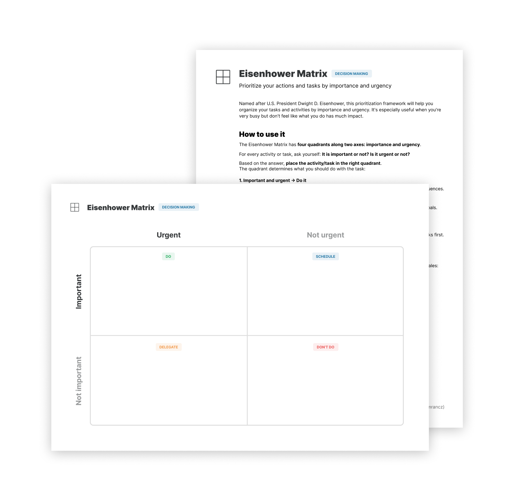

## 核心理解

按预期影响和所需投入评估任务，优先处理高影响、低投入事项，并识别大型项目、填充任务和低回报工作。

## 中文长文

按预期影响和所需投入安排优先级。

影响—投入矩阵是一种决策工具，帮助你根据任务可能产生的影响以及完成任务所需的投入来确定优先级。当任务清单很长、需要决定把精力用在哪里才能取得更好结果时，它尤其有用。

### 如何使用

影响—投入矩阵由影响和投入两条轴线划分为四个象限。对每个任务或项目，问自己：它能产生多大影响？需要投入多少精力？

根据回答把任务放入相应象限，再用象限辅助决定如何处理：

1. **高影响、低投入 → 快速收益**
   
   - 这类任务或项目应优先处理，因为它们能以较少投入带来较高回报。
     
   - 例如，小幅改进就能显著提升用户体验，或简单修复就能避免重大问题。
     
   
2. **高影响、高投入 → 重点项目**
   
   - 这类事项很重要，但需要投入大量时间和资源。先处理快速收益，再规划和执行这类项目。
     
   - 例如开发新功能、开展营销活动或重做网站。
     
   
3. **低影响、低投入 → 填充任务**
   
   - 有空闲时间时可以处理。这些事情影响不大，但完成起来容易。
     
   - 例如常规行政工作、小幅优化或细微更新。
     
   
4. **低影响、高投入 → 吃力不讨好的任务**
   
   - 这类任务需要很多投入，却带不来多少回报。尽可能避免或减少。
     
   - 例如可以简化却过于复杂的流程，或没有必要的会议。
     
   

这个矩阵既适用于工作，也适用于个人任务。它能帮助你找出值得投入时间和精力的事情，以及回报有限的事项。

你也可以按不同时间尺度使用它：规划每日工作、每周回顾或管理长期项目。

### 补充建议

1. **使用准确的输入**
   
   - 现实地评估任务影响和投入。避免低估投入或高估影响，必要时征求外部意见。
     
   
2. **定期回顾**
   
   - 定期重新检查矩阵，确保任务优先级仍与实际情况和变化相符。
     
   
3. **结合其他工具**
   
   - 可以将影响—投入矩阵与[艾森豪威尔矩阵](https://untools.co/eisenhower-matrix/)等框架结合使用，进一步细化优先级。
     
   

### 示例

下面是一些可能放入影响—投入矩阵的任务：

||**低投入**|**高投入**|
| ------------| ----------------------------------| ------------------------------------------------|
|**高影响**|快速收益：修复小缺陷；改善界面|重点项目：开发新功能；重做网站|
|**低影响**|填充任务：常规行政工作；小幅优化|吃力不讨好的任务：过度复杂的流程；不必要的会议|

### 要点

影响—投入矩阵帮助你优先处理投入产出更好的任务。如果你经常忙碌却看不到明显成果，这个工具可以帮助你找到精力应放在哪里。用它梳理工作，确保投入集中在最有价值的事情上。

## 动手练习

作者制作了影响—投入矩阵模板（PDF 和 Miro 版本），包含操作步骤和示例。

该模板可通过 Untools Vault 获取；其中还提供 Untools 的高级模板和每月专题内容。

模板预览：

### 来源

[《影响与投入：用于任务优先级排序的简明矩阵》](https://www.bitesizelearning.co.uk/resources/impact-vs-effort-matrix-explanation-template)

# 回想：这项任务可能产生多大影响？

## 名称

影响—投入矩阵

## 适用情境

当你面对较长的任务清单、不确定先做哪项，或需要比较多个项目的潜在收益与投入、讨论团队资源分配和优先级时，可以用这张卡梳理影响与投入的对应关系，辅助判断先做什么。

## 自问

- 这项任务可能产生多大影响？
  
- 完成它需要多少时间和资源？
  
- 估算是否有依据？
  
- 情境变化后优先级是否需要调整？
  

## 例子

- 修复影响广泛的小缺陷可能属于高影响、低投入的快速收益；开发大型新功能可能属于高影响、高投入的重点项目。
  

## 边界

- 影响与投入估算不可信时
  
- 忽略依赖、风险或战略约束，仅按象限自动排序时
  

## 行动步骤

- 列出待评估的任务或项目
  
- 估计每项的预期影响和完成投入
  
- 放入四象限
  
- 优先处理高影响低投入任务
  
- 规划重要的大型项目
  
- 酌情安排填充任务并避免低影响高投入事项
  
- 定期根据变化重新评估
  

## 使用提示

帮助用户逐项估计影响和投入并归入四象限；核对估算依据，提醒其定期重审。将矩阵作为讨论工具，不用象限替代对依赖、风险和战略目标的判断。

## 出处

Untools，《Impact\-Effort Matrix》：https://untools\.co/impact\-effort\-matrix/。文章还引用 Bitesize Learning；中文内容据本地英文原文翻译。
