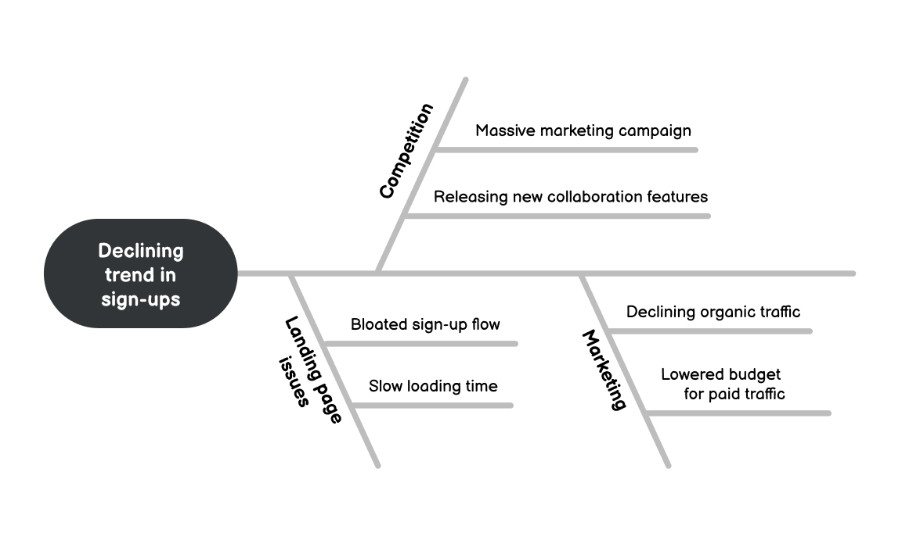
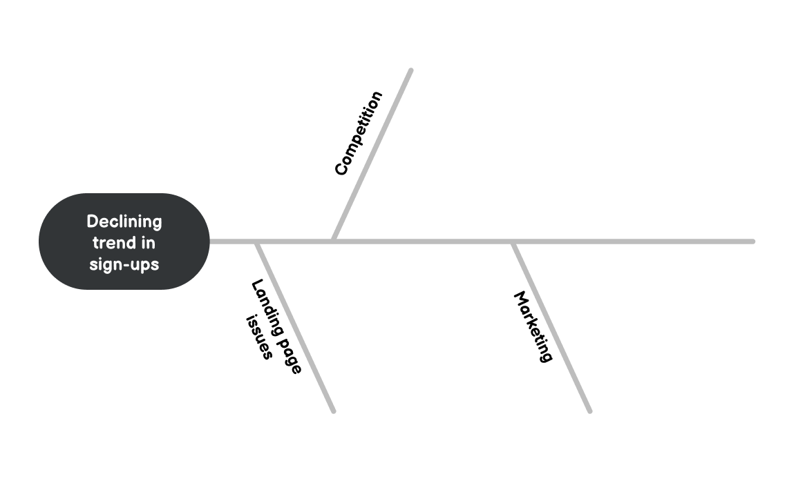
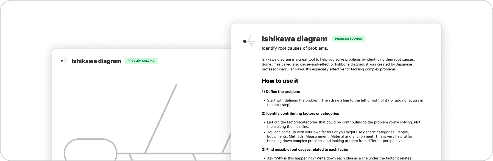

## 核心理解

围绕明确的问题，分组梳理可能的影响因素和原因，为后续调查根因提供结构。

## 中文长文

找出问题的可能根因。

石川图是一种帮助解决问题、识别潜在根因的实用工具。它也称为因果图或鱼骨图，由日本教授石川馨创立，对分析复杂问题尤其有效。

## 如何使用

绘制石川图只需几个简单步骤。你可以独自完成，也可以在团队工作坊中一起绘制。

#### 1）定义问题

先把问题描述清楚，再从问题处向左或向右画出主线，方向由你决定。

接下来将在这条主线上添加影响因素。

#### 2）找出促成问题的因素或类别

列出可能促成当前问题的因素或类别，并把它们画在主线周围。

你可以自行确定类别，也可以使用常见分类：人员、设备、方法、测量、材料和环境。

分类有助于拆解复杂问题，并从不同角度审视问题。

#### 3）为每个因素寻找可能的根因

追问“为什么会发生这种情况？”，把每种想法写在对应因素的分支下。[第一性原理](https://untools.co/first-principles/)思维在此处很有帮助，其中也包括“五个为什么”方法。

请记住，一个问题可能不止一个根因。即使某个因素只能部分解释问题，也应把所有可能的原因记录下来。

此时，你应该已经有一张完整的图，但还没有得到确定答案。

#### 4）分析图表

最重要的一步是审视并分析所有可能的根因。图表此时为关键思考和后续行动提供了结构。

你可以采取多种行动：为每个候选根因收集更多数据或证据，也可以识别最可能的原因并迅速尝试解决。下一步取决于具体问题和已识别的候选原因。

## 示例

下面看一个实际案例。

假设你是产品经理，需要解决新用户注册量持续下降的问题。先把问题定义清楚，再找出可能的影响因素。

这个例子中，影响因素包括落地页、竞争和营销。

接下来，在每个因素下面寻找具体的候选根因：

写下这些原因后，就可以开始分析问题从哪里产生。在这个例子中，可以先核实流量减少时转化率是否保持稳定，再检查注册流程，找出可能的流失环节并尝试简化。

这是一个简化的示例，但石川图也可用于分析复杂得多的问题。

### 动手练习

作者制作了石川图模板（PDF 和 Miro 版本），包含步骤说明和示例。

该模板可通过 Untools Vault 获取；其中还提供 Untools 的高级模板和每月专题内容。

## 要点

石川图为寻找问题根因提供了一个简单框架：

1. 定义问题。
   
2. 找出促成问题的因素或类别。
   
3. 找出与各因素相关的可能根因。
   
4. 分析图表。
   

前三步用于绘图，图表随后为分析提供结构。

### 来源

[HarvardX，《如何绘制因果图》（视频）](https://youtu.be/mLvizyDFLQ4)

[American Society for Quality，《鱼骨图》](https://asq.org/quality-resources/fishbone)

# 回想：要解释的问题是什么？

## 名称

石川图

## 适用情境

一个问题可能有多类成因，需要组织团队一起排查时使用。它帮助你围绕明确的问题陈述，按类别展开候选原因，再找出值得进一步验证的线索。

## 自问

- 要解释的问题是什么？
  
- 哪些类别可能促成了问题？
  
- 每个因素背后还有哪些可能原因？
  
- 哪些候选原因需要数据进一步验证？
  

## 例子

- 新用户注册量持续下降时，可把落地页、竞争和营销列为因素，再分别查找具体原因并验证转化率与注册流程。
  

## 边界

- 把图中列出的候选原因当成已证实根因时
  
- 尚未定义清楚待解释的问题时
  

## 行动步骤

- 准确界定问题并画出主骨
  
- 列出可能的因素类别
  
- 把各类别画为分支
  
- 追问每个因素下可能的原因
  
- 分析并为候选根因收集证据
  
- 依据证据选择调查或试行的下一步
  

## 使用提示

帮助用户清楚描述问题，将候选因素分类并逐层追问可能原因；明确图表只是分析结构，列出的原因仍需数据或调查验证，不要直接宣布根因。

## 出处

Untools，《Ishikawa Diagram》：https://untools\.co/ishikawa\-diagram/。文章还引用 HarvardX 与 American Society for Quality；中文内容据本地英文原文翻译。
