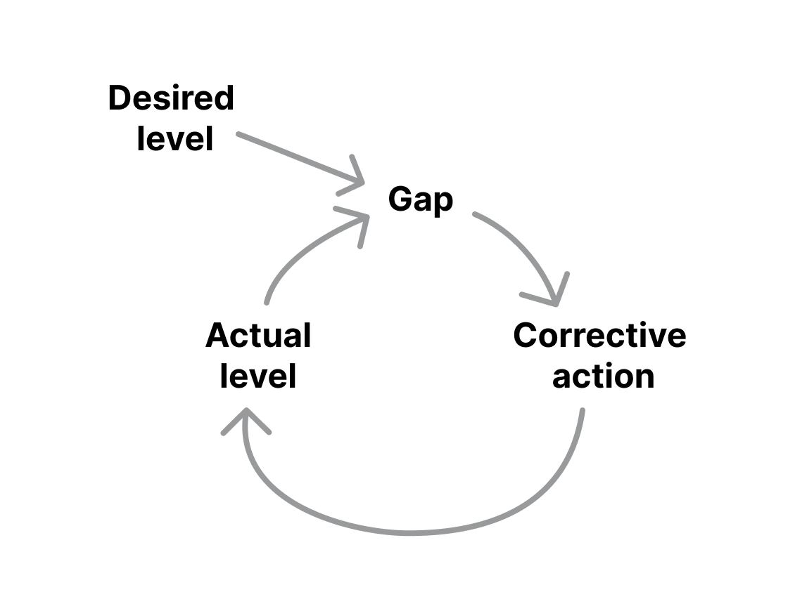
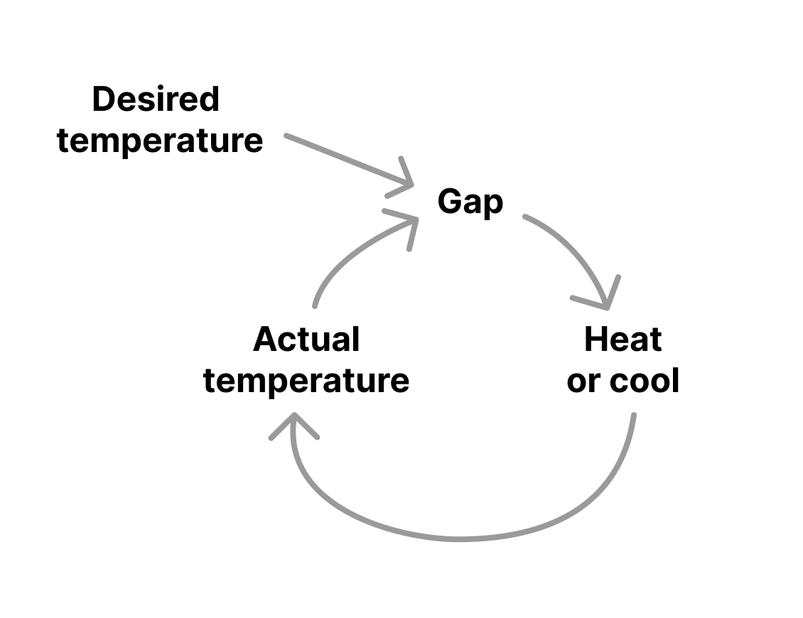

## 核心理解

一种抵消偏离、推动实际状态接近目标水平的反馈机制，常使系统趋于稳定。

## 中文长文

通过抵消变化来维持稳定的机制。

平衡反馈回路会抵抗某一方向上的进一步变化。它以相反方向的变化抵消原有变化，目的是让系统保持稳定。

系统中常能同时看到平衡回路和[强化反馈回路](https://untools.co/reinforcing-feedback-loop/)；后者会产生相反效果，使变化不断放大。

## 平衡回路如何运作

平衡回路有三个重要组成部分：

- 目标或期望水平
  
- 当前实际水平
  
- 两者之间的差距
  ​
  

当回路检测到差距时，就会触发纠偏行动，让某个实际状态向期望水平靠近。

理解某个具体的平衡回路，关键在于找出它的目标。目标有时并未明说，也不容易立即看出来。

## 示例

恒温器是一个很直观的平衡反馈回路。它监测室内温度（实际水平）；当温度低于或高于某个阈值（期望水平）时，就启动制热或制冷，让温度保持在设定范围内。

在这个例子中，整个回路是人为设计的，纠偏行动也是有意安排的。自然界中也有许多平衡回路。例如，一杯刚泡好的热茶放在一旁，会逐渐从较高的初始温度（实际水平）冷却到室温（期望水平）。这里的纠偏作用是茶水与周围空气之间的热量传递。这个过程自然发生，并没有意图。

## 要点

平衡反馈回路会努力让系统趋于稳定。它通过触发纠偏行动来接近某个目标，因此具有自我调节的特征。

它与[强化反馈回路](https://untools.co/reinforcing-feedback-loop/)相反；强化反馈回路会让变化不断放大。

### 来源

[Donnella Meadows，《系统思考：入门指南》](https://www.goodreads.com/book/show/3828902-thinking-in-systems)

[Justin Farrugia，《可视化设计背后的系统》](https://uxdesign.cc/visualizing-the-systems-behind-our-designs-7a7c95b4cfb2)

[Systems Thinker，《强化回路与平衡回路：动态系统的构成要素》](https://thesystemsthinker.com/reinforcing-and-balancing-loops-building-blocks-of-dynamic-systems/)

[Systems Thinker，《平衡回路基础》](https://thesystemsthinker.com/balancing-loop-basics/)

# 回想：系统试图维持或达到什么目标？

## 名称

平衡反馈回路

## 适用情境

系统在变化后又回到某个范围，或调整措施似乎不断被抵消时使用。它帮助你找出目标水平、实际状态和两者差距，理清触发纠偏行动的反馈过程。

## 自问

- 系统试图维持或达到什么目标？
  
- 实际状态与目标之间有什么差距？
  
- 什么行动会缩小这个差距？
  

## 例子

- 恒温器监测室温，温度偏离设定范围时启动制热或制冷；茶水则会自然向室温冷却。
  

## 边界

- 需要解释持续放大变化的机制时，应同时考察强化反馈回路
  

## 行动步骤

- 明确系统目标或期望水平
  
- 识别当前实际状态
  
- 描述两者之间的差距
  
- 找出响应差距的纠偏动作及其结果
  

## 使用提示

分析平衡反馈回路时，依次找出目标水平、实际水平、两者差距和纠偏动作；检查该动作是否让实际状态更接近目标，并说明目标是否明确可见。

## 出处

Untools，《Balancing feedback loop》：https://untools\.co/balancing\-feedback\-loop/。文章列出的补充来源保留在英文原文中；中文内容据本地英文原文翻译。
