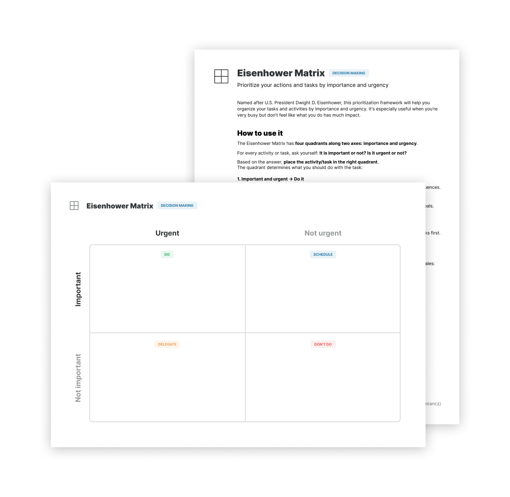

## 核心理解

按重要性和紧急程度将任务分为四类，并分别采取执行、安排、委派或不做的处理方式。

## 中文长文

按重要性和紧急程度安排任务与行动。

这个优先级框架以美国总统 Dwight D. Eisenhower 命名，帮助你按照重要性和紧急程度组织任务与活动。当你忙得不可开交，却觉得所做的事情没有什么影响时，它尤其有用。

## 如何使用

艾森豪威尔矩阵由重要性和紧急性两条轴线划分为**四个象限**。对每项活动或任务，问自己：它重要吗？它紧急吗？

根据答案把任务放入相应象限，再按象限决定如何处理：

#### 1. 重要且紧急 → 立即做

- 这类任务应尽快完成。
  
- 包括危机、迫切问题，以及现在不行动就会产生负面后果的事情。
  

#### 2. 重要但不紧急 → 安排时间

- 为这些任务预留时间，到时完成。
  
- 深度工作通常发生在这个象限：它们能推动项目或长期目标。
  

#### 3. 紧急但不重要 → 委派

- 如果可以，找其他人代为处理。
  
- 如果无法委派，可以安排稍后处理，但应优先做重要且不紧急的任务。
  
- 这类任务常是行政事务，或有截止日期但并非关键的事情。
  

#### 4. 不紧急也不重要 → 不做

- 这类任务不值得投入时间，应当停止做。
  
- 逃避性活动、忙碌但无产出的工作和娱乐活动都可能属于这一象限。
  

这也是任务优先级的大致顺序。没错，重要但不紧急的任务应排在紧急但不重要的任务之前。

艾森豪威尔矩阵很灵活，既可以用于工作任务，也可以用于个人事务，或者两者兼顾。

你也可以按不同时间尺度使用它：既可规划一天，也可用于更长期地安排生活中的活动。

### 怎样区分紧急和重要？

紧急任务通常有明确的截止时间（例如给客户发送草稿），或者需要及时回应（例如处理邮件）。重要任务则往往与你的长期目标一致（例如锻炼），或能推动项目进展（例如为个人项目编写代码）。

判断紧急性与重要性始终取决于具体情境，以及你能否识别真正紧急和真正重要的事情。

## 示例

下面列出一些可能放入艾森豪威尔矩阵的任务和活动：

||**紧急**|**不紧急**|
| ------------| --------------------------------------------------------| -------------------------------------------------------------|
|**重要**|*立即做：*完成即将到期的报告；给客户发送草稿；修复缺陷|*安排：*设计新功能；写博客文章；锻炼|
|**不重要**|*委派/稍后安排：*购买会议门票；安排面试；回复邮件|*不做：*参加没有议程的会议；浏览 #random 频道；查看社交媒体|

## 要点

艾森豪威尔矩阵希望通过设定正确的优先级并采取行动，提高你的效率。如果你总是很忙，却无法推进长期项目和目标，这个工具可能适合你。它也可以帮助你一般性地判断该做什么、该从生活中删去什么。

## 动手练习

作者制作了艾森豪威尔矩阵模板（PDF 和 Miro 版本），包含操作步骤和示例。

该模板可通过 Untools Vault 获取；其中还提供 Untools 的高级模板和每月专题内容。

模板预览：

### 来源

[James Clear，《如何用“艾森豪威尔盒子”提高效率并消除浪费时间的活动》](https://jamesclear.com/eisenhower-box)

[Todoist，《艾森豪威尔矩阵》](https://todoist.com/productivity-methods/eisenhower-matrix)

# 回想：这件事对目标重要吗？

## 名称

艾森豪威尔矩阵

## 适用情境

每天被紧急事务占满，却觉得长期目标没有进展时使用。它帮助你分开任务的重要性与紧急程度，判断哪些立即处理、安排时间、委派或减少。

## 自问

- 这件事对目标重要吗？
  
- 它是否有明确时限或需要及时响应？
  
- 能否委派？
  
- 它值得投入时间吗？
  

## 例子

- 截止时间临近的报告属于重要且紧急；长期项目规划属于重要但不紧急；一般邮件可能紧急但不重要；无议程会议可能既不重要也不紧急。
  

## 边界

- 把紧急程度误当作重要性，或忽略任务之间的依赖关系时
  

## 行动步骤

- 逐项列出任务
  
- 分别判断每项任务的重要性和紧急程度
  
- 重要且紧急的立即处理
  
- 重要但不紧急的安排时间
  
- 紧急但不重要的尽量委派
  
- 既不重要也不紧急的删除或停止投入
  

## 使用提示

逐项按重要性与紧急性分类，明确建议执行、安排、委派或不做；提醒用户重要但不紧急的事项通常关系到长期目标，不要被眼前的紧急事务挤掉。

## 出处

Untools，《Eisenhower Matrix》：https://untools\.co/eisenhower\-matrix/。文章还引用 James Clear 和 Todoist；中文内容据本地英文原文翻译。
