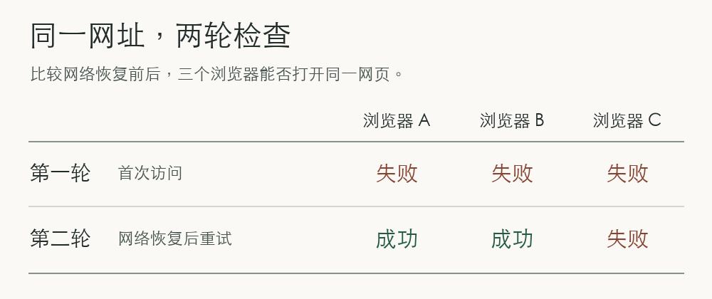

## 核心理解

如果几种解释都能说明眼前的现象，先问每种解释还需要哪些条件成立。需要额外假定的条件越少，越值得优先检验。这里的「简单」要看解释依赖多少未经证实的前提。一个只有两个字的解释，比如「巧合」，也可能暗含好几件彼此独立的事。

## 适用情境

当几个地方出现同一种异常，而你只有时间先查一处时，可以用这条原则安排调查顺序。先确认这些地方是否确有共同环节，比如几次失败的访问是否用了同一条网络连接。

## 如何运用

1. 写下各方都能核对的观察。把你对成因的猜测另起一行。
2. 为每个解释列出它必须借用的前提。已经查明的事实可以共用，尚待核实的条件要逐项比较。
3. 先查最省假设的解释所指向的证据。用[[falsifiability|可证伪性]]追问自己「看到什么结果，我就该放弃这个解释？」并在查看证据前写下答案。

## 例子

同一台电脑上的三个浏览器都打不开同一个网址。猜「共用的网络连接断了」，只需假定一处故障。猜「三个浏览器各有一个故障」，则要分别解释三次失败。于是先查网络。假如断网是唯一原因，网络恢复后，三个浏览器都应该能打开这个网址。

恢复网络后再试，浏览器 A 和 B 打开了网页，C 仍然失败。这时可以把排查范围缩小，看看 C 显示了什么错误。两次测试的条件和结果见[浏览器排查笔记](assets/reading-notes.md)。

## 边界与误用

网络恢复后的结果超出了单一网络故障的预测。断网仍然可能解释第一轮共同的失败，第三个浏览器的表现却需要更多证据。为了维持「原因只有一个」而略去这条记录，就会错过这次排查最值得追的线索。
